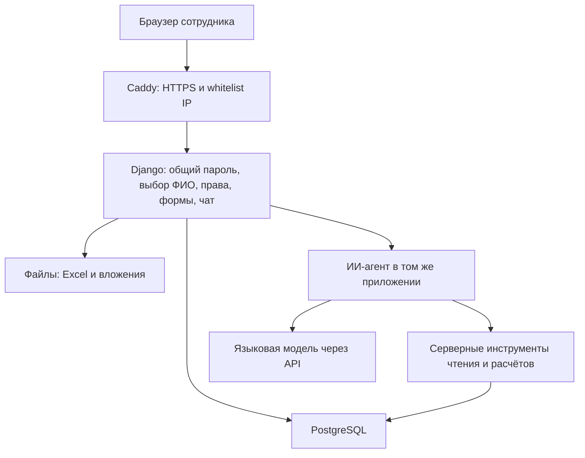

# Архитектура пилота LIMS

Дата: 01.11.2026. Статус: согласовано для реализации.

## Цель и границы

Создать простой облачный пилот для хранения и анализа лабораторных исследований, создания новых рецептур и экспериментов, общения с ИИ-агентом и переноса существующих данных по зимней пене.

Ориентир — рабочая первая версия, которую можно собрать совместно за один день. Срок полного переноса зависит от проверки охвата зимних материалов и неоднозначностей в архиве.

Модель данных согласуется в отдельном обсуждении. Этот документ фиксирует архитектуру и поведение системы; состав сущностей, таблиц, полей и связей остаётся открытым. Реализацию схемы БД, форм и сопоставления при импорте начинаем после согласования модели.

## Функциональность первой версии

- База исследований с данными из существующих Excel и возможностью анализа агентом.
- Просмотр, поиск и создание рецептур и экспериментов через веб-интерфейс.
- Разграничение права создавать данные по роли выбранного сотрудника.
- Общий пароль для входа на сайт, затем выбор ФИО из подготовленного списка.
- Whitelist разрешённых IP-адресов и подсетей, который легко изменить в конфигурации.
- Чат с ИИ-агентом для поиска и анализа данных исследований.
- Перенос данных по зимней пене с проверкой результата импорта.

## Состав приложения

Один проект Django обслуживает веб-страницы, формы, сессии, проверку прав, импорт и чат. Для рабочих страниц используются серверные шаблоны и формы Django; встроенная административная панель служит техническим интерфейсом настройки справочников и прав.

| Компонент | Решение | Назначение |
| --- | --- | --- |
| Приложение | Python, Django, серверные шаблоны и формы | Интерфейс, прикладная логика, сессии и права |
| База | PostgreSQL, Django ORM и миграции | Структурированные исследования; схема согласуется отдельно |
| Файлы | Постоянный каталог на сервере, подключённый как volume | Исходные Excel и вложения |
| Агент | Python, API языковой модели, серверные инструменты | Поиск, сравнение и анализ исследований |
| Внешний вход | Caddy | HTTPS, IP whitelist, передача запросов Django |
| Запуск | Docker Compose на одной облачной виртуальной машине | Совместный запуск приложения, PostgreSQL и Caddy |
| Разработка | Git, миграции Django, серверные и браузерные проверки | История изменений и проверка ключевых сценариев |

## Доступ и роли

Порядок входа:

1. Caddy проверяет внешний IP посетителя по whitelist.
2. Посетитель вводит общий пароль сайта.
3. После успешного ввода выбирает ФИО сотрудника; сервер сохраняет выбранный профиль в сессии.
4. Django проверяет права выбранного профиля при каждом действии.

Две рабочие роли:

- **Читатель** — просматривает исследования и общается с агентом.
- **Автор** — дополнительно создаёт новые рецептуры и эксперименты.

Общий пароль разрешает вход на сайт, а роль выбранного ФИО определяет право создавать данные. Скрытие кнопки в интерфейсе сопровождается серверной проверкой прав.

Подтверждение личности не требуется: участники пилота доверяют друг другу. Любой вошедший может выбрать любое доступное ФИО и получить соответствующую роль. Указанное ФИО обозначает выбранное авторство, но не удостоверяет личность человека.

Управление списком ФИО и назначением ролей выполняется через технический административный доступ. Выбор ФИО сам по себе не предоставляет административных привилегий.

Общий пароль хранится в виде хеша в конфигурации окружения; API-ключ модели и другие секреты передаются вне Git. Проверка пароля выполняется на сервере. Django использует серверную проверку сессий и защиту изменяющих запросов от CSRF.

## Whitelist IP и сеть

Разрешённые внешние IPv4/IPv6-адреса и подсети CIDR задаются в одном конфигурационном файле Caddy. Для изменения списка достаточно обновить этот файл и перезагрузить конфигурацию прокси.

Ограничение применяется ко всем путям приложения, включая вход, административный интерфейс, чат, запросы к данным и вложения. Внешний доступ к Django и PostgreSQL напрямую закрыт; публичный веб-вход проходит через Caddy.

В начальной схеме Caddy принимает соединения непосредственно от посетителей. Если перед ним появится другой прокси, получение клиентского IP и доверенные прокси настраиваются явно.

## ИИ-агент

Агент доступен на отдельной странице чата внутри приложения. Пользователь задаёт вопрос обычным языком; агент обращается к данным через серверные инструменты поиска, чтения карточек и расчёта сводок.

В первой версии агент работает только на чтение. Создание рецептур и экспериментов выполняется через формы с проверкой роли. Проверки сессии, доступа и допустимых операций выполняет сервер при обращении к инструментам.

Численные расчёты выполняет код. Ответы содержат ссылки на использованные записи, пояснение выбранных условий сравнения и указание недостающих данных. Результаты разных режимов испытаний сопоставляются с явным указанием различий.

Провайдер и конкретная языковая модель выбираются перед подключением API. Ключ хранится в окружении сервера. Логика агента входит в проект Django и использует описание согласованной схемы данных.

## Перенос зимней пены

Перенос входит в объём пилота. В проекте уже есть подготовленная [полная структурированная выгрузка](../Пена/data/pena-experiments-all.parquet), [реестр рецептур](../Пена/reports/pena-accepted-recipes.jsonl), [контракт выгрузки](../Пена/docs/pena-parquet-format.md) и [отчёт экспорта](../Пена/reports/pena-parquet-export.json). Их используем как основу для подготовки импорта с проверкой по первичным Excel.

Охват зимней пены проверяем по происхождению данных. Зимние книги серий 302 и 316 дают начальный ориентир; полнота охвата остальных зимних материалов требует проверки. Готовые выборки для обучения моделей не считаются полным архивом зимних исследований.

Сопоставление с рабочей БД определяется после согласования модели данных. При переносе сохраняем первичные файлы, происхождение записей, исходные комментарии, пропуски и неоднозначности. Связь с плановой рецептурой сама по себе не подтверждает фактическое изготовление.

Импорт сопровождается отчётом о перенесённых записях, пропусках и материалах, требующих проверки. Несколько карточек сверяются с первичными Excel. Повторный запуск импорта должен распознавать уже перенесённые записи. Существующие исходники остаются источниками для сверки.

## Развёртывание и проверка

На одной облачной виртуальной машине Docker Compose запускает Django, PostgreSQL и Caddy. Данные PostgreSQL и файлы хранятся в постоянных volumes. Резервное копирование охватывает БД и файлы; перед рабочим использованием проверяется восстановление.

Для запуска потребуются сервер, адрес сайта и настройка HTTPS, разрешённые IP, общий пароль, список ФИО с ролями и доступ к API модели. Эти значения задаются при развёртывании.

После отдельного согласования модели последовательность реализации следующая:

1. Создать проект, схему БД и формы.
2. Добавить общий пароль, выбор ФИО и серверные проверки ролей.
3. Подготовить и проверить импорт зимней пены.
4. Подключить чат и инструменты чтения и анализа.
5. Развернуть приложение, настроить IP whitelist и резервное копирование.

Проверки первой версии: отказ при неверном пароле и запрещённом IP; невозможность создать данные под ролью читателя, в том числе прямым запросом; создание записи автором; корректность импорта; ответы агента со ссылками и отсутствие изменений БД через агентные инструменты; сохранность данных после перезапуска.

Документ описывает согласованное устройство будущего пилота. Приложение, импорт, подключение модели и развёртывание пока не выполнены.

## Документация инструментов

- [Формы Django](https://docs.djangoproject.com/en/stable/topics/forms/modelforms/).
- [Пользователи и права Django](https://docs.djangoproject.com/en/stable/topics/auth/default/).
- [Административный интерфейс Django](https://docs.djangoproject.com/en/stable/ref/contrib/admin/).
- [IP-фильтры Caddy](https://caddyserver.com/docs/caddyfile/matchers#remote_ip).
- [Docker Compose](https://docs.docker.com/compose/).
