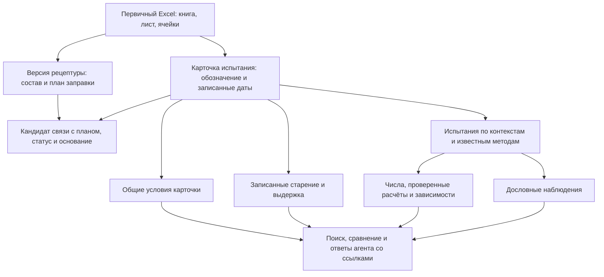

# Модель данных пилота LIMS по первичным Excel

Версия: 1.0. Дата утверждения: 01.11.2026. **Статус: утверждено пользователем для реализации пилота** в рамках согласованной [архитектуры](architecture.md).

Актуализация 03.11.2026: ниже сохранена историческая модель ядра 1.0 и её
демонстрационный DDL. Действующая схема задаётся `lab/models.py` и всеми
миграциями в `lab/migrations/`. В приложении поставщик, плотность, цена и
валюта принадлежат партии; свойства исходного плана сохраняются отдельно.
Общие условия перенесены в результаты групп измерений, `SessionCondition`
удалена. `RecipeVersion.formulation` хранит исходные параметры
[редактора состава и заправки](docs/recipe-editor.md). Расчётные шаблоны удалены,
пользовательский раздел шаблонов рецептур отключён; прежние связи и снимки
рецептур сохраняются. Текущие возможности описаны в [README](README.md) и
[дополнении модели](docs/functionality-v1.1.md). Встроенный
[ИИ-ассистент](docs/assistant.md) читает БД и разрешённые файлы;
начальный архив импортируется из подготовленного снимка Excel. Загрузка
произвольного XLSX через интерфейс сама по себе не импортирует строки.

Утверждён сокращённый объём: версии рецептур и план заправки → карточки испытаний → условия, результаты, расчёты, наблюдения и обработка. Учёт исследовательских задач, физических изготовлений, фактических навесок и индивидуальных объектов отложен. Архив не требует предварительного восстановления этих сведений.

[Подробный разбор полей и примеров](data-model-walkthrough.md),
[DDL ядра](examples/relational/schema.sql), [строки из Excel](examples/relational/tables.md)
и [SELECT](examples/relational/queries.sql) конкретизируют историческое решение;
они не являются полной схемой текущего приложения. Отдельный
[SQL будущего расширения](examples/relational/optional-process-extension.sql)
в объём пилота не входит.

Утверждение означает согласование модели и границ первой версии. Оно не удостоверяет правильность каждой исходной ячейки, не подтверждает лабораторный регламент и не превращает автоматическое сопоставление в доказательство фактического изготовления.

Рабочая трактовка пользователя: `316` — тип смеси, например зимняя пена; `.8` — версия рецептуры. В БД это `mixture_type` и `recipe_version`. Обозначение `316.8` не идентифицирует отдельный баллон или замес. Исходные обозначения сохраняются, в том числе при конфликтующих полных планах под одним номером.

## Основание и границы анализа

Источник истины — оригинальные Excel. По уточнению пользователя Parquet не валидирован и не используется как доказательство состава, связей, числа опытов или достоверности результатов. Прежние документы служили навигацией; примеры ниже проверены непосредственно в книгах.

Независимый структурный проход по `Пена/pena/` прочитал XML **236 XLSX, 234 различных файлов по SHA-256, 4 631 листа**. Сигнатуры шаблонов: 2 115 рецептурных листов, 2 471 лист с признаками карточки испытания, 38 иных и 7 без сохранённых значений/формул. Это классификация структуры, а не число рецептур, физических образцов, проведённых опытов или пригодных результатов. Наличие шаблона не подтверждает заполненность и правильность данных.

Для предметных выводов подробно рассмотрены выбранные листы обычных рецептур, STP, матрицы, карточек 105/302/316, проверки сырья HJC, сторонних образцов и внешних физико-механических испытаний. В [excel-source-evidence.json](analysis/excel-source-evidence.json) сохранены независимый реестр книг с хешами и адресные свидетельства: исходные значения, формулы и их непроверенные кэши. Пустой журнал теплопроводности проверен как шаблон, без приписывания ему результатов.

Воспроизведение из корня рабочей папки:

```bash
Пена/.venv/bin/python LIMS/scripts/inspect_excel_sources.py
```

Скрипт использует стандартную библиотеку Python, читает только XLSX и записывает только свой JSON. Он не читает Parquet и прежние отчёты, не вычисляет формулы и не выполняет импорт в LIMS. Структурный проход не заменяет предметную проверку каждого из 4 631 листа. Старый каталог `Пена/source/`, Word/PDF, бумажные журналы и реальная работа сотрудников не входят в этот полный проход.

## Что в Excel определяет модель

Пути в таблице начинаются от `Пена/pena/`. Имена листов, включая конечные пробелы, значимы для происхождения.

| Первичный пример | Проверенное содержание | Следствие |
| --- | --- | --- |
| `Разработка рецептур/316 ЗИМНЯЯ УЛУЧШЕННАЯ.xlsx`, `316.26` | F1=`316.26`, B2=`316`; D4=12.8, G4=`ROUND(D4*$G$3/100,1)`, G3=350; строки 33–40 рассчитывают заправку; F49=1000 — номинальный объём баллона | Состав смеси, масштаб расчёта приготовления и заправка — разные части плана. Расчётные массы не являются фактическими навесками |
| Там же, A4:E4 и A13:D13 | A4 содержит название с `п.260613G`, B4=112, E4 — взвешенный вклад OHV; TCPP также входит в доли смеси | Материал, партия и свойство разделяются; база долей — вся смесь A с добавками. OHV материала и расчёт OHV смеси имеют разный смысл |
| `Разработка рецептур/STP рецептура.xlsx`, `40` и `43` | Оба D1=`STP 40`; одинаковые строки смеси, но B27/B28=85/15 и 84/16; G29=453 и 457; E21=`F152a` и `Изобутан` | Один исходный номер соответствует разным полным планам. Версия включает смесь, газы, заправку и расчётные параметры |
| Та же книга, `2`, A13:D13 | Подпись `Isocyanat` присутствует, соответствующие значения пусты | Пустой элемент шаблона не доказывает присутствия изоцианата. Нельзя делать A/B обязательной химической моделью для всех продуктов |
| `Разработка рецептур/Архив/801 рецептура.xlsx`, `Лист1` | B1/C1/D1=`801.12`/`801.13`/`801.14`; материалы по строкам, составы по колонкам; строка 38 — ISO index, 39–40 — параметры газов | Один лист содержит несколько планов; параметры нельзя импортировать как компоненты. База этих чисел требует самостоятельной проверки |
| `Разработка рецептур/316 рецептура с фреоном 152а.xlsx`, `316Ф-2` | E24/A37/F56 указывают F152a, E37 — F134a | Сохраняется противоречие, нормализованный газ не выбирается по догадке |
| `Испытания разработки рецептур/316.xlsx`, `316.8` и `316.8 (2)` | B3 в обоих=`316.8`; C2/F2: 04/14.08.2026 и 18/19.08.2026; B14/B15: 5/20 и 6/21 мин | Это разные карточки с разными датами и результатами. Номер рецептуры не идентифицирует физический баллон и не доказывает тип повтора |
| Та же книга, `316.8`, C6/E6/G6, B25/C26:I26/B27 | Масса выпуска — разность взвешиваний; плотность рассчитана по массе и размерам; выход рассчитан через плотность | Нужны исходные замеры и цепочка расчётов. Масса выпуска не равна плановой или фактической массе заправки |
| Та же книга, `316.17 стар.пол.`, B16/F16 | B16 пусто, F16=`((3-B16)/3)*100`, сохранённый кэш F16=100 | Этот кэш не подтверждает усадку 100%. Формула и кэш сохраняются отдельно от принятого результата |
| `Испытания разработки рецептур/302.xlsx`, `302.19(ст.бал)`, B4 | `302.19(стар.баллона после стар полиола) 1 мес к.к.` | Есть последовательное старение смеси и баллона. Срок, объект и порядок обработки — отдельные данные; `к.к.` не переводится в придуманную температуру |
| Та же книга, `302.19(ст.бал1,5)`, B4/C2/F2 | В тексте `1,5 мес к.к.`, даты 02.11.2021 и 10.01.2022 | Записанная длительность обработки и календарное время между датами хранятся раздельно |
| `Испытания разработки рецептур/Проверка нового сырья/HJC.xlsx`, `830 ст.пол` и `830 ст.пол+ст.бал` | B4 различает обработку, но не устанавливает её температуру/длительность; оценка B11=`5-`; B16/C16 содержат парные отсчёты | Обработка допускает неполное описание; порядковая оценка и отдельные определения не сводятся к одному float |
| `Испытания разработки рецептур/105.xlsx`, `105.1`, B18:B21 | Последовательные наблюдения по рядам выпуска | Ряды выпуска — контекст наблюдений, а не автоматически четыре независимых образца |
| `Испытания разработки рецептур/Сторонние образцы.xlsx`, `экопласт `, B4/C2/F2/B16/C23 | Экопласт, дата изготовления пуста, испытание 03.02.2022; `всадка:2,91;2,86`; `и  подготовили 3 образца на растяжение` | Допускается неизвестный состав; исходный объект может давать несколько образцов. Подготовка не подтверждает проведённое растяжение |
| `Испытания разработки рецептур/Физ.мехи/Analysis 1st Round -  2024R11P15 PU FOAMS RUSSIA - KUDO.xlsx`, `L1-MU-M`, C5:G9/E46:G48 | FEICA TM 1019, kg/m3; F5:F9 — пять плотностей, G5 — их среднее. E46=`< 0,050`, F46:F48 — определения, G46 — итог | Методика, единица, отдельные определения, сводное значение и требование — разные записи. Пять определений не доказывают пять независимых изготовлений |
| `Испытания разработки рецептур/Физ.мехи/Теплопроводность /Журнал опредления коэффициента теплопроводности.xlsx`, `Лист1` | Только заголовки A1:D1, результатов нет | Шаблон не создаёт фиктивные испытания |

## Утверждённый процесс пилота



В веб-интерфейсе создаются рецептуры и карточки испытаний. Термин «эксперимент» в описании функциональности пилота обозначает такую карточку; отдельная исследовательская задача не является обязательным контейнером. Карточка может содержать несколько испытаний и сохраняется без установленного состава. Для новой записи LIMS исходного Excel может не быть.

Записанная дата изготовления хранится прямо в карточке. Система не создаёт по ней вымышленный замес, физический баллон или навески. Неудачные и неполные испытания, текстовые результаты и неизвестные условия сохраняются.

## Таблицы утверждённого ядра

Ядро демонстрационного DDL содержит 20 таблиц. Имена ниже совпадают с SQL. Внутренние ключи — `bigint`; человекочитаемые номера не заменяют идентификаторы. `?` означает nullable. Типы и назначение каждого поля разобраны в [walkthrough](data-model-walkthrough.md).

### Сырьё, состав и заправка

| Таблица | Смысл и основные связи |
| --- | --- |
| `mixture_type` | Тип смеси: `code`, читаемое `title?`; например 316 |
| `recipe_version` | Полный план версии: `mixture_type_id?`, текстовое `version_label`, указанная дата `recorded_on?`, `source_sheet_id?`. Подпись версии не является глобальным уникальным ключом |
| `recipe_group` | Приготовляемая смесь внутри плана: `recipe_version_id`, `label`, общая `quantity_basis`, `completeness`. Устанавливает, к чему относятся количества компонентов |
| `material` | Предложенная каталожная марка сырья: `name`; одинаковое написание не доказывает химическую эквивалентность разных поставок |
| `material_lot` | Указанная партия: `material_id`, `lot_code`. Номер партии из плана не подтверждает её расходование |
| `recipe_component` | Строка состава: `group_id`, порядок `position`, **либо** `unbatched_material_id?`, **либо** `specified_lot_id?`, доза `quantity_value?` и ячейки названия/дозы. База и версия выводятся через группу |
| `filling_plan_line` | Строка заправки: `recipe_version_id`, альтернативно группа смеси, марка или партия; `mass_g?`, `mass_status`, исходные ячейки подписи и массы/формулы |
| `recipe_property` | Параметр конкретного плана: `property_code`, `value`, `unit_code?`, `source_cell_id?`; ровно один владелец — версия, группа, компонент или строка заправки. Например OHV, NCO, A:B и объём баллона |

**`recipe_group` — «состав приготовляемой смеси».** Это внутренний состав, например смеси A. В `316.8` 12.8% Puranol относится к массе этой смеси с добавками, а не всей заправки. `recipe_component` перечисляет ингредиенты; сама группа задаёт их общую базу. Она не обозначает тип продукта 316 и не является операцией приготовления.

В пилоте обычная рецептура может иметь одну автоматически создаваемую группу: сотруднику не нужна отдельная форма управления группами. Если подтвердится, что во всём рабочем объёме всегда одна смесь и одна база, отдельный уровень можно впоследствии убрать без изменения предметного смысла. В текущем ядре он сохранён как явно заданная база долей и объект ссылки из плана заправки; несколько смесей не требуются от пользователя.

**`filling_plan_line` — «строка плана заправки баллона».** Она сообщает, сколько приготовленной смеси либо отдельного сырья предусмотрено для баллона. Строка смеси ссылается на группу, а не копирует её ингредиенты. Состав смеси и её масса в заправке — разные величины. Равенство смеси двух версий не устанавливает равенство газа, A:B или плана заполнения.

Версия охватывает состав, газ, заправку и существенные параметры. Изменение полного плана создаёт новую неизменяемую версию. Печатные повторы одного расчёта Excel не создают дополнительные строки заправки. Непроверенный кэш формулы остаётся в источнике; в `mass_g` переносится непосредственно заданная либо независимо проверенная плановая масса. Фактических навесок в этой таблице нет.

### Карточки, условия и результаты

| Таблица | Смысл и основные связи |
| --- | --- |
| `test_session` | Карточка: `source_sheet_id?`, `identifier_cell_id?`, записанные даты изготовления/испытания. Ссылок на исследование, изготовление или физический объект пилот не требует |
| `recipe_match` | Кандидат соответствия карточки полному плану: `session_id`, `recipe_version_id`, `status`, `reason`. Несколько кандидатов допустимы, не более одного подтверждённого планового соответствия |
| `test_run` | Контекст испытания в карточке: `session_id`, `scope`, `method_code?`, `scope_cell_id?`. Бумага, форма и куб разделяются; неизвестная методика не угадывается |
| `metric` | Определение показателя: `code`, `label`, каноническая `unit_code?`, `value_kind` — numeric/text/ordinal |
| `session_condition` | Доказанно общие условия карточки: `session_id`, `metric_id`, одно численное или текстовое значение и источник. Температура испытания не подменяет температуру старения |
| `result` | Одно определение или расчёт: `test_run_id`, `metric_id`, число/текст, `origin`, `value_state`, `source_cell_id?`, `calculation_code?`. Отсутствующее значение не превращается в ноль |
| `result_dependency` | Конкретные входы расчёта: `result_id`, `input_result_id`, `role`. Алгоритм и использованные определения — разные сведения |
| `observation` | Дословный текст: `test_run_id`, `sequence_no`, `text_value`, `source_cell_id?`. Ряды выпуска не становятся отдельными образцами |
| `conditioning_event` | Записанная обработка при карточке: `session_id`, `target_kind`, `step_no`, `kind`, известные длительность/единица и температура, `source_cell_id?`. Физический ID не требуется |

`recipe_match` связывает документальную карточку с планом и не подтверждает фактический состав или независимость изготовления. Например, две карточки `316.8` имеют разные даты, но найденный лист рецептуры датирован позже первой карточки. Сохраняются две карточки и кандидаты, без фиктивной физической связи.

`origin` различает внесённое и вычисленное; `value_state` — доступное значение, неразобранную запись, отсутствующие операнды и непроверенную формулу. `recorded` означает «записано в источнике», а не «утверждено приборным измерением». Человеческая проверка записи и состояние работы — самостоятельные свойства прикладного процесса.

Старение смеси и баллона сохраняется отдельными событиями с `target_kind=blend/can`. В `302.19(ст.бал)` явно указано старение баллона после старения полиола. Пометка `1 мес к.к.` сохраняется целиком, но её область и численная температура не достраиваются. Начальные даты/сложные режимы обработки добавляются при появлении соответствующего учёта, не блокируя перенос имеющихся записей.

### Первичные источники

| Таблица | Смысл и основные связи |
| --- | --- |
| `source_file` | Исходный путь, SHA-256 точных байтов и система дат Excel |
| `source_sheet` | `file_id`, точное имя листа, включая конечные пробелы |
| `source_cell` | `sheet_id`, адрес, тип XML, буквальное значение, отдельные формула и непроверенный кэш, числовой формат |

Байты исходных файлов сохраняются отдельно по согласованной архитектуре. Реестр ячеек не заменяет книгу с её комментариями, объединениями и вложениями. Типизированное значение и исходная запись имеют разные роли: пригодное для запросов извлечение и неизменяемое свидетельство.

## Эксперимент, изготовление и физические объекты — отложенный блок

Это перспективная модель работы, а не шесть обнаруженных журналов Excel. Описания ниже объясняют необходимость сущностей при соответствующем процессе; их заполнение не является требованием пилота.

| Сущность | Зачем нужна | Что есть в проверенных Excel | Решение |
| --- | --- | --- | --- |
| `experiment` — исследование | Хранит цель и объединяет связанные рецептуры/испытания. Одну рецептуру могут проверять ради разных вопросов | Названия книг/папок дают контекст; отдельная явная постановка задачи для каждой карточки не установлена | Необязательная будущая группировка; архив переносится без неё |
| `experiment_variant` — вариант плана исследования | Заранее задаёт сравниваемый состав/обработку и контроль. Один состав может иметь разные плановые режимы | Различающиеся составы и режимы видны, но принадлежность одному плану сравнения требует отдельного решения | Исключён из ядра и из SQL расширения; добавлять только при востребованном планировании серий |
| `preparation_run` — фактическая операция | Отделяет конкретное приготовление/заправку от рецептуры-инструкции; хранит дату, тип операции и обстоятельства | В двух карточках 316.8 разные даты изготовления, но подробный журнал операций и ID замесов по этим ячейкам не восстанавливается | Отложен; известную дату изготовления сейчас хранить в карточке |
| `preparation_input` — фактические входы | Показывает реально использованные сырьё, партии и количества конкретной операции; позволяет анализировать отклонения от плана | В рецептуре есть названия с партиями и расчётные дозы. G4 вычисляет количество, а не регистрирует отвешивание | Отложен до регистрации фактических навесок; расчётные массы сюда не копировать |
| `sample` — физический объект | Идентифицирует конкретный баллон, смесь, блок пены или вырезанный образец и связывает испытания одного объекта | В C23 карточки «экопласт » записана подготовка трёх образцов; их индивидуальные ID и последующее испытание этой записью не установлены | Отложен до отдельной маркировки и отслеживания объектов |
| `conditioning_event` — обработка | Различает старение смеси, баллона и другие воздействия; режим зависит от объекта/стадии | Явные записи старения смеси и баллона есть в 302 и HJC, длительности/температуры могут быть неполными | Входит в пилот как документальное событие при карточке, без `sample_id` |

Отсутствие полного журнала в этих примерах не доказывает отсутствия сведений во всех 4 631 листе. При обнаружении дополнительных первичных данных они сохраняются и могут стать основанием расширения.

При появлении реального учёта цепочка будет такой: операция приготовления → физическая смесь → вход операции заправки → физический баллон → испытание. Операция — действие, объект — его физический результат; их идентичности различны. У одной операции несколько входов/выходов, поэтому одной ссылки `parent_sample_id` недостаточно.

В будущем `actual_mass_g` относится ко всему запуску операции. Для индивидуальных дозировок в каждый баллон нужен отдельный fill-запуск либо явное распределение по выходам. Общая доза групповой операции не приписывается каждому баллону. Подтверждение планового соответствия не создаёт автоматически эту физическую цепочку.

[Отдельный SQL расширения](examples/relational/optional-process-extension.sql) показывает четыре возможные таблицы и подключение к ядру. Это заготовка будущего этапа; запускать её для пилота не требуется. Права, история исправлений и авторство по выбранному ФИО реализуются служебным слоем приложения по архитектуре, а не фиктивными физическими объектами.

## Правила целостности и переноса

1. **Excel — источник истины.** Parquet и прежние отчёты могут служить навигацией, но не подтверждают значения или связи. Первичные байты, исходные тексты, формулы, кэши, пропуски и противоречия сохраняются.
2. **Один канонический путь связи.** Марка известной партии выводится через партию; версия компонента — через группу; единица результата — через метрику; карточка результата — через испытание. У одной строки не заполняются альтернативные источники одновременно.
3. **Полный план версионируется.** Исходный код не уникален глобально. Опубликованная версия и её дочерние строки неизменяемы; изменения создают новую версию. Планы с одинаковой смесью и разной заправкой не сливаются.
4. **Пропуск не равен нулю.** Неполная рецептура отмечается; неизвестный газ или пустая строка не объявляются нулевыми. База и сумма проверяются внутри группы; архив не перенормируется. Прежний аналитический допуск 95–105% не является нормой выпуска нового рецепта.
5. **Числа и расчёты проверяются отдельно.** Непроверенный кэш находится только в источнике. Для принятого расчётного результата нужны алгоритм, конкретные операнды и согласованные единицы. Ошибка формулы не становится физическим отказом; реальный отказ сохраняется наблюдением и известными измерениями.
6. **Методы и режимы не смешиваются.** Бумага, форма, куб, разные сроки и установленные методы сохраняются раздельно. Несколько определений, ряды выпуска, копии и сводки не объявляются независимыми изготовлениями.
7. **Даты сохраняют точность источника.** Календарная дата хранится как `date`; технические моменты приложения — `timestamptz`. Противоречивые архивные даты не исправляются догадкой. Календарный месяц не превращается автоматически в 30 суток.
8. **Импорт воспроизводим.** Фиксируются версии извлечения и хеши. Повторная загрузка неизменённого документа распознаёт прежние записи. Изменённый файл — новый источник; связь с прежней карточкой проверяется, а не выводится из пути. Все копии и дополнительные источники сохраняются; подтверждённая копия не создаёт новый независимый опыт.
9. **Ссылки и изменения контролируются.** Рабочие отношения — FK с защитой от каскадного удаления истории. Принадлежность группы нужной версии, соответствие типа/единицы, неизменяемость и отсутствие циклов расчётов проверяются при реализации транзакционно. Сумму дочерних строк нельзя считать обеспеченной построчным CHECK.
10. **Авторство не удостоверяет личность.** Выбранное ФИО и права соответствуют согласованной архитектуре. История исправлений и основание изменения обязательны для рабочего приложения; отметка проверки не является электронной подписью.

Структурированный импорт начинается с сохранения источников, выделения содержательных блоков (в том числе колонок матрицы), независимого извлечения планов и карточек. Затем создаются кандидаты соответствия с причинами. Сходство имени, папка, дата или результаты не выбирают произвольный единственный состав. Неразобранные блоки остаются в отчёте и raw-слое, не теряются ради успешного импорта.

Отчёт переноса раздельно считает файлы/листы/блоки, версии плана, карточки, испытания, определения показателей, неоднозначные связи и ошибки. Число листов не считается числом независимых экспериментальных точек. Отдельные карточки сверяются с исходными Excel; исходники не перезаписываются.

## Проверка модели и реализация

Утверждённое ядро проверяется на сценариях:

- два STP 40 с одинаковой смесью и разной заправкой сохраняются разными версиями;
- 316.8 и 316.8 (2) дают разные карточки с исходными датами, без вымышленных баллонов;
- разные методы одной карточки не затирают показатели друг друга;
- F16=100 при пустом B16 остаётся кэшем, принятого результата усадки нет;
- старение смеси и баллона сохраняется разными документальными событиями;
- сторонний образец и текстовый неуспех сохраняются без известной рецептуры и без нулей вместо пропусков;
- повторный импорт не размножает прежние записи, исправление сохраняет историю и источники.

Генераторы, SQL и примеры проверяют адресные факты и согласованность структуры. PostgreSQL в этой работе не запускался; DDL примера не является готовой рабочей миграцией. При реализации нужны миграции Django, правила версионирования, история изменений, авторство, проверки прав и отчёт импорта. Демонстрационный SQL не заменяет эти обязанности.

Вопросы маркировки объектов, реальных навесок, значения «повтор» и лабораторного регламента относятся к будущему расширению и уточнению форм. Они не требуют повторного согласования уже утверждённого ядра и не блокируют документальный пилот.

## Зафиксированное решение

01.11.2026 пользователь одобрил сокращённую модель. К реализации принят описанный документальный пилот, версия 1.0. Исследовательские задачи и расширенный физический процесс вынесены за его границы. Детальное описание полей, SQL и примеры согласованы с этим объёмом.
