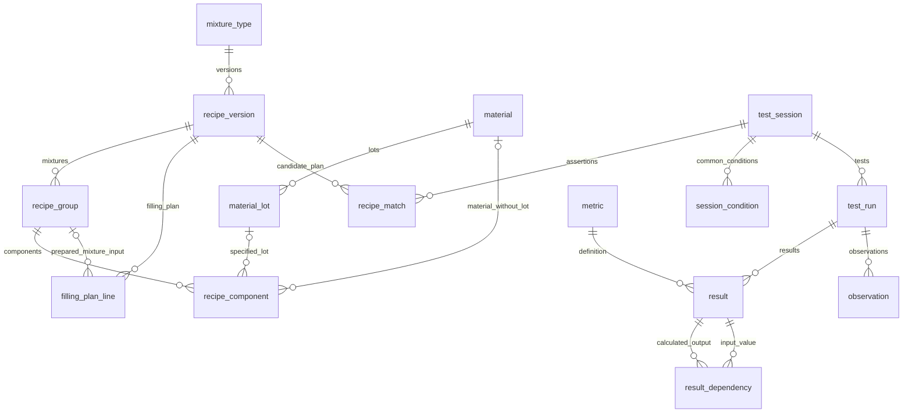
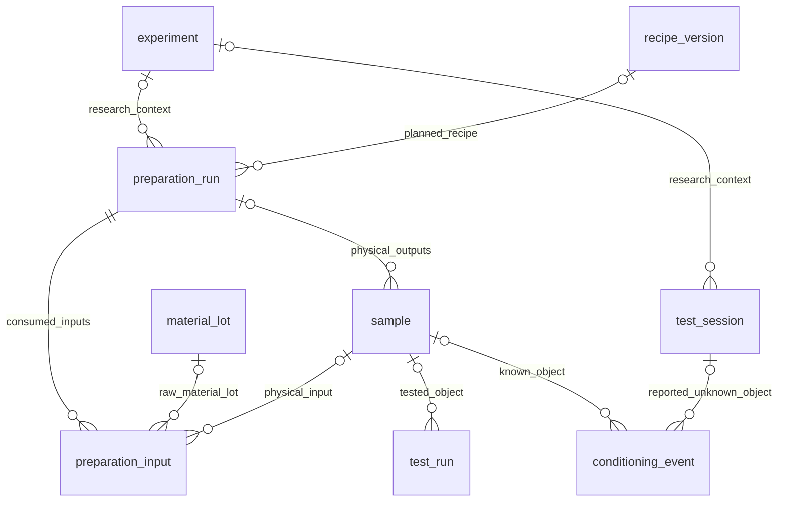

# Как выглядят таблицы LIMS: связи, поля и строки из Excel

Дата исходного разбора: 01.11.2026. **Историческое ядро 1.0: 20 таблиц,
110 полей и 40 FK.** Этот разбор конкретизирует
[утверждённый proposal](data-model-proposal.md); приведённые таблицы, SQL,
диаграммы и идентификаторы относятся к демонстрации ядра, а не к полной
схеме текущего приложения. Отдельно описаны четыре таблицы будущего физического
учёта — они не входят в пилот и вынесены из основного DDL. Не каждое
nullable-поле обязательно для каждого опыта.

Актуализация 03.11.2026: действующая схема определяется `lab/models.py`
и всеми миграциями `lab/migrations/`. Условия из `session_condition` перенесены
в результаты групп измерений; отдельная таблица удалена. Поставщик, плотность,
цена и валюта принадлежат партии. `RecipeVersion.formulation` хранит исходные
параметры [редактора состава и заправки](docs/recipe-editor.md), расчётные
шаблоны удалены, раздел шаблонов рецептур отключён. Текущие действия описаны
в [README](README.md), правила исследования данных и проекта —
в [справке ассистента](docs/assistant.md).

Материалы разбора:

- [CREATE TABLE утверждённого ядра с типами, FK и CHECK](examples/relational/schema.sql).
- [Отложенный физический учёт: отдельный SQL-набросок](examples/relational/optional-process-extension.sql), не применяется для пилота.
- [Таблицы с конкретными строками и всеми колонками](examples/relational/tables.md).
- [INSERT этих строк](examples/relational/data.sql), [те же строки в JSON](examples/relational/rows.json).
- [Шесть SELECT для просмотра связей](examples/relational/queries.sql).
- [Воспроизводимое чтение исходных Excel](scripts/build_relational_example.py).

Числа и тексты примеров заново прочитаны из пяти первичных XLSX, девяти выбранных листов. Parquet не используется. Внутренние ID назначены для иллюстрации; они не являются найденными номерами баллонов, замесов или опытов. Разделение текста на марку и явно указанный суффикс партии — предложенная нормализация записи, не подтверждение поставщика, химической эквивалентности или фактического расходования партии.

## 1. Как читать схему

Во всех предметных таблицах `id bigint PRIMARY KEY` — техническая идентичность записи. Один и тот же номер `316.8` может встречаться в разных карточках и конфликтующих планах. Поэтому имя и номер не заменяют `id`. В рабочем приложении ID назначает БД; в демонстрации они заданы явно для читаемости.

`*_id` — ссылка на строку другой таблицы, а не копия её полей. `NULL` означает, что значение неизвестно или неприменимо; установленный ноль хранится как `0`. `?` ниже означает nullable. Одна строка справа может иметь только указанного родителя; у родителя допускается много дочерних строк.



У компонента ссылка на марку и ссылка на партию — **альтернативы**, а не две одновременно заполненные связи. У партии уже есть материал. `recipe_match` — утверждение о соответствии карточки плану, которое не устанавливает физический объект или фактические навески. Поля `sample_id` в ядре нет; физическая связь предусмотрена только будущим расширением.

Диаграмма показывает основные связи, а не все служебные FK. В SQL их полный перечень. Общие поля `id` объяснены здесь один раз; ниже объяснены остальные поля каждой таблицы.

## 2. Тип смеси, версия рецептуры и её состав

### mixture_type — что разрабатываем

| Поле | Зачем нужно и что не повторяет |
| --- | --- |
| `code text` | Код семейства, например `316`. По рабочей трактовке пользователя — тип смеси. Не является версией или номером физического объекта |
| `title text?` | Читаемое название для каталога. Для связей используется ID, поэтому название можно уточнить без замены ссылок |

Пример:

| id | code | title |
| --- | --- | --- |
| 1 | 316 | Зимняя пена — рабочая трактовка типа смеси |
| 2 | STP | STP — название семейства книги |

Отдельный справочник позволяет вывести все версии типа `316` без разбора тысяч строковых номеров. Поле `title` удобно, но не обязательно для целостности.

### recipe_version — какой полный план зафиксирован

| Поле | Зачем нужно и что не повторяет |
| --- | --- |
| `mixture_type_id bigint?` | Связь с типом смеси. Не храним рядом ещё одну копию кода `316`; получаем его через эту связь. NULL допустим у неразобранной архивной принадлежности |
| `version_label text` | Обозначение версии: `8`, `26`, `40`, в будущем и `8.1`. Текст нужен для подверсий и буквенных обозначений; отдельного дублирующего целочисленного `revision_no` нет |
| `recorded_on date?` | Дата, указанная на листе рецептуры. Не дата изготовления образца и не техническое время загрузки файла |
| `source_sheet_id bigint?` | Лист, откуда получен этот план. У созданной в LIMS версии Excel может отсутствовать |

Конкретные строки:

| id | mixture_type_id | version_label | recorded_on | source_sheet_id |
| --- | --- | --- | --- | --- |
| 1 | 1 | 8 | 2026-08-18 | 101 |
| 2 | 1 | 26 | 2026-09-08 | 102 |
| 3 | 2 | 40 | 2024-05-20 | 103 |
| 4 | 2 | 40 | 2024-05-20 | 104 |

Листы 101/102 — `316 ЗИМНЯЯ УЛУЧШЕННАЯ.xlsx / 316.8` и `/ 316.26`; 103/104 — `STP рецептура.xlsx / 40` и `/ 43`. Исходное полное обозначение `316.8` или `STP 40` остаётся в исходной ячейке. Не вводится второй канонический код, который пришлось бы синхронизировать с кодом типа и версией.

У строк 3 и 4 одинаковая подпись версии, но разные полные планы. Поэтому нет глобального UNIQUE по подписи. Для новых утверждённых планов уникальную нумерацию можно задать отдельным правилом; архивный конфликт нельзя устранять удалением одной строки. Версия охватывает состав, заправку и существенные параметры; изменение любого из них создаёт новую версию.

### recipe_group — база, к которой относятся доли

| Поле | Зачем нужно и что не повторяет |
| --- | --- |
| `recipe_version_id bigint` | Родительский план. У компонента отдельной ссылки на версию уже нет: она выводится через группу |
| `label text` | Название группы/смеси, например `Recipe for polyol`. Это обозначение области состава, а не обязательная химическая классификация |
| `quantity_basis text` | `mass_percent`, `weight_parts` или `unknown`. Число 12.8 без базы не определяет дозировку. У компонентов этой группы база повторно не хранится |
| `completeness text` | Известно ли, что состав полный: `unknown`, `complete`, `partial`. Даже сумма около 100 не доказывает правильность извлечения всех строк |

Группа 1 относится к плану 1 (`316.8`), база — массовые проценты всей смеси с добавками. Все четыре примера имеют `completeness=unknown`: сверены значения выбранных листов, но это не утверждение технологом полной рецептуры. Пустые дозы шаблона не объявляются нулевыми.

Понятное название для пользователя — «состав приготовляемой смеси», например смеси A. Это внутренняя часть рецептуры, а не тип продукта 316 и не отдельное изготовление. В пилоте одна группа может создаваться автоматически: отдельную форму и несколько смесей от сотрудника не требуем. Если рабочий объём всегда имеет ровно одну смесь и базу, уровень можно позднее убрать; в текущем ядре он задаёт базу долей и ссылку из заправки.

### material и material_lot — марка отдельно от партии

| Таблица / поле | Зачем нужно и что не повторяет |
| --- | --- |
| `material.name text` | Каталожное имя материала. Имя хранится один раз, а компоненты ссылаются на запись. В примере сохраняются различия `YD-307` и `Inovol C307`; эквивалентность не предполагается |
| `material_lot.material_id bigint` | Какая марка имеет эту партию. Благодаря этой связи компонент с известной партией не хранит вторую ссылку на ту же марку |
| `material_lot.lot_code text` | Записанное обозначение партии, например `BPD6126523`. Сам номер не гарантирует глобальной уникальности и ничего не говорит о фактическом использовании |

Пример:

| material.id | material.name | material_lot.id | material_lot.material_id | lot_code |
| --- | --- | --- | --- | --- |
| 1 | Puranol D210 | 1 | 1 | BPD6126523 |
| 2 | YD- C310 | 2 | 2 | 26041502 |
| 2 | YD- C310 | 8 | 2 | 26062309 |
| 6 | HGD-8806 | — | — | партия не указана |

Исходное `Puranol D210 п.BPD6126523` сохраняется в ячейке A4. Разделённая партия в плане означает «указана в рецептуре». Её реальное дозирование доказывается отдельно через изготовление. Для первых архивных загрузок можно вообще не нормализовать названия: оставить обе ссылки компонента NULL, сохранив исходную ячейку.

### recipe_component — одна строка состава

| Поле | Зачем нужно и что не повторяет |
| --- | --- |
| `group_id bigint` | К какой смеси относится строка. Даёт версию и базу через родителя |
| `position integer` | Порядок отображения строк; в примере сохранён номер строки Excel. Не означает порядок дозирования |
| `unbatched_material_id bigint?` | Марка, если конкретная партия не установлена. Не заполняется вместе со `specified_lot_id` |
| `specified_lot_id bigint?` | Партия, указанная в плане. Марка получается через неё, а не дублируется |
| `name_cell_id bigint?` | Где записано исходное имя с партией и примечаниями. Позволяет проверить предложенную нормализацию |
| `quantity_value numeric?` | Доза в базе группы. В группе массовых процентов 12.8 означает 12.8% смеси, не 12.8 г и не 12.8% всей заправки |
| `quantity_cell_id bigint?` | Какая ячейка обосновывает дозу. Это другое свидетельство, чем ячейка названия |

Ненулевые строки группы 1 (`316.8`), с округлением только для показа:

| component.id | specified_lot_id | unbatched_material_id | Исходная марка | quantity_value | Источник |
| --- | --- | --- | --- | --- | --- |
| 1 | 1 | NULL | Puranol D210 | 12.8 | A4 / D4 |
| 2 | 2 | NULL | YD- C310 | 17.7 | A5 / D5 |
| 3 | 3 | NULL | YD-307 | 26.4 | A6 / D6 |
| 4 | 4 | NULL | TCPP | 36.5 | A13 / D13 |
| 5 | 5 | NULL | DMDEЕ | 1.1 | A14 / D14 |
| 6 | NULL | 6 | HGD-8806 | 4 | A16 / D16 |
| 7 | 6 | NULL | Metastab AK-88906 | 1.5 | A18 / D18 |

Для `316.26` реальные строки уже другие: Inovol C210 — 12.8; YD- C310 другой указанной партии — 17.7; Inovol C307 — 26.4; TCPP — 36.5; DMDEЕ — 1.1; Metastab AK-8872 — 1.4; Metastab AK-88906 — 4.1. Общий тип смеси не позволяет перезаписать состав версии 8 составом версии 26.

В XML встречается `1.1000000000000001`. В SQL и JSON этот хвост сохранён; значения не перенормированы. Показ 1.1 здесь — форматирование, не исправление источника.

### filling_plan_line — что запланировано загрузить в баллон

«Строка плана заправки» — отдельная доза приготовленной смеси, изоцианата или газа. Состав отвечает, что находится внутри смеси A; заправка — сколько этой смеси и другого сырья предусмотрено для баллона. Это объясняет разную заправку при одинаковом составе STP 40 и не требует учёта реальной операции заправки в пилоте.

| Поле | Зачем нужно и что не повторяет |
| --- | --- |
| `recipe_version_id bigint` | К какому полному плану относится заправка. Для строк отдельного сырья это невозможно получить через группу |
| `input_group_id bigint?` | Ссылка на уже описанную смесь, например группу 1. Не копируем её компоненты повторно в заправку |
| `unbatched_material_id bigint?` | Непосредственно загружаемая марка, например Dismadur или DME, если партия не указана |
| `specified_lot_id bigint?` | Непосредственно загружаемая известная партия. Три варианта входа — группа, марка или партия — взаимоисключающие |
| `label_cell_id bigint?` | Исходная подпись строки `Polyol`, `Iso`, `DME` и т. п. При противоречии сырьё можно оставить ненормализованным |
| `mass_g numeric?` | Только принятая плановая масса в граммах. Единица зафиксирована именем колонки; отдельной `unit_id` с постоянным значением g нет |
| `mass_cell_id bigint?` | Источник указанной массы или формулы. Кэш остаётся в этой исходной ячейке |
| `mass_status text` | `recorded`, `calculation_unchecked`, `calculation_checked`, `unknown`. Отличает неизвестную массу от непроверенного расчёта и от принятого нуля |

Пример `316.8`:

| line.id | Вход | mass_g в плане | mass_status | Ячейка | Только кэш Excel, г |
| --- | --- | --- | --- | --- | --- |
| 1 | группа 1 | NULL | calculation_unchecked | F33 | 279.7 |
| 2 | Dismadur | NULL | calculation_unchecked | F34 | 357.1 |
| 3 | DME | NULL | calculation_unchecked | F36 | 71.2 |
| 4 | F134a | NULL | calculation_unchecked | F37 | 0 |
| 5 | Prop/IB | NULL | calculation_unchecked | F38 | 82.2 |

Непроверенные кэши не импортируются в `mass_g`, в том числе кэш 0. Нижние B57:G57 ссылаются на те же расчёты; новые строки заправки из этого повторного печатного блока не создаются.

Когда `input_group_id` заполнен, группа должна принадлежать той же версии плана. В этом небольшом DDL соответствие проверяется прикладным кодом; составной FK или триггер — вариант усиления перед рабочим применением. Сам по себе FK на существующую группу ещё не доказывает нужную принадлежность.

### recipe_property — контекстные свойства и параметры плана

| Поле | Зачем нужно и что не повторяет |
| --- | --- |
| `recipe_version_id bigint?` | Владелец, когда параметр относится ко всему плану, например целевой объём заполнения |
| `group_id bigint?` | Владелец, когда параметр относится к смеси, например расчётный масштаб приготовления |
| `component_id bigint?` | Владелец свойства строки состава, например её указанного OHV |
| `filling_plan_line_id bigint?` | Владелец свойства строки заправки, например NCO указанного изоцианата. Ровно один из четырёх владельцев заполнен |
| `property_code text` | Какое свойство записано: `ohv`, `nco`, `gas_mass_pct`, `target_fill_volume` и т. п. Это не ещё один тип материала |
| `value numeric` | Записанное значение свойства. Не является дозой компонента |
| `unit_code text?` | Единица этого свойства. NULL, если она не установлена. В отличие от метрик здесь нет отдельного справочника, который уже задавал бы единицу |
| `source_cell_id bigint?` | Основание значения в первичном листе |

Примеры: у компонента 1 OHV=113.67 из B4; у строки заправки 2 NCO=31.06 из I2; у версии 1 целевой объём заполнения 802 мл из G32 и номинальный объём баллона 1000 мл из F49. Это разные величины. G3=350 хранится как расчётный масштаб с неизвестной в этом примере единицей, а не как факт приготовления 350 г. Отношение A:B задаётся двумя свойствами строк заправки `reference_ab_mass`: 100 г из C23 и 128 г из C24. Это опорные количества для расчёта соотношения, а не массы заправки конкретного баллона.

OHV 113.67 относится к указанной строке плана. Он не переносится автоматически на всю марку или реальную партию. Столбец E4 — взвешенный вклад OHV — остаётся формулой в источнике, а не вторым «OHV материала».

Для двух STP 40 в typed-слое хранится газовая массовая доля 15 или 16; дополнительная каноническая колонка «остальная доля 85 или 84» не нужна при проверенной двухчастной базе. Исходные обе цифры остаются в Excel. Аналогично сумма компонентов и общая масса заправки — запрос/расчёт, а не вручную поддерживаемые копии.

## 3. Одна карточка и несколько испытаний

### test_session — документальная карточка

| Поле | Зачем нужно и что не повторяет |
| --- | --- |
| `source_sheet_id bigint?` | Контекст карточки/листа, включая карточки с пустым номером. Не означает физический объект |
| `identifier_cell_id bigint?` | Какая конкретно ячейка содержит исходный номер/название: в разных шаблонах B3 или B4. Это решение извлечения, которое нельзя восстановить одним фиксированным адресом |
| `recorded_manufactured_on date?` | Какую дату изготовления указали в карточке. Это утверждение документа, а не найденный запуск изготовления |
| `recorded_tested_on date?` | Дата испытания из карточки. Не копия даты рецептуры |

| session.id | Лист 316.xlsx | Номер в B3 | recorded_manufactured_on | recorded_tested_on |
| --- | --- | --- | --- | --- |
| 1 | 316.8 | 316.8 | 2026-08-04 | 2026-08-14 |
| 2 | 316.8 (2) | 316.8 | 2026-08-18 | 2026-08-19 |

Контекст листа и указатель на ячейку номера частично связаны: у архивного номера его лист можно получить через ячейку. Контекст сохраняется отдельно, потому что карточка допустима и без номера. Это осознанная служебная избыточность; совпадение листа требуется проверять, а не считать две ссылки независимыми истинами. `experiment_id` и `sample_id` в ядре не требуются. Слово «эксперимент» в интерфейсе пилота может обозначать карточку; отдельная исследовательская задача отложена.

### recipe_match — почему карточку связали с планом

| Поле | Зачем нужно и что не повторяет |
| --- | --- |
| `session_id bigint` | Какая карточка сопоставлена |
| `recipe_version_id bigint` | Какой полный план является кандидатом |
| `status text` | `candidate`, `confirmed`, `rejected`. Совпадение надписи само по себе даёт только кандидата |
| `reason text` | Основания и противоречия сопоставления. Статус без причины не позволяет проверить решение |

PK здесь — пара `(session_id, recipe_version_id)`, отдельного `id` не требуется. Несколько кандидатов возможны, подтверждённый план может быть не более одного. Связь **многие ко многим** нужна потому, что один план испытывается многократно, а старая карточка может иметь несколько возможных планов.

В примере обе карточки имеют кандидата `recipe_version_id=1`. Для session 1 есть противоречие: её испытание **14.08.2026**, а найденный план датирован **18.08.2026**. Для session 2 совпадение даты изготовления с датой плана тоже не доказывает фактических навесок. Поэтому обе связи — `candidate`.

Если записать `recipe_version_id` непосредственно в карточке без статуса и основания, неопределённость исчезнет из модели. Если скопировать эту ссылку в каждый результат, её придётся исправлять во многих строках. В текущей схеме ссылка хранится один раз на карточку и кандидат.

### test_run — в каком контексте получили результаты

| Поле | Зачем нужно и что не повторяет |
| --- | --- |
| `session_id bigint` | Какая карточка объединяет эту работу. У результата отдельной ссылки на карточку нет |
| `scope text` | Область: `paper`, `can_checks` и т. п. Плотность на бумаге и плотность в форме не сливаются |
| `method_code text?` | Известная методика. В примере NULL: заголовок «ТЕСТ НА БУМАГЕ» не даёт права придумать стандарт/редакцию |
| `scope_cell_id bigint?` | Какая подпись/область карточки обосновывает группировку |

| run.id | session_id | scope | method_code |
| --- | --- | --- | --- |
| 1 | 1 | paper | NULL |
| 2 | 1 | can_checks | NULL |
| 3 | 2 | paper | NULL |
| 4 | 2 | can_checks | NULL |

`can_checks` — техническая группировка записанных взвешиваний и оценок, не придуманная самостоятельная методика. Пустой блок «ТЕСТ В ФОРМЕ» не создаёт проведённое испытание. `scope` отвечает «в каком контексте», `method_code` — «каким установленным методом»: это разные оси.

### metric — что означает число или оценка

| Поле | Зачем нужно и что не повторяет |
| --- | --- |
| `code text` | Устойчивое имя показателя для запросов, например `tack_free`. Не совпадает по смыслу с ID конкретного результата |
| `label text` | Читаемая подпись: «Время отлипа». Позволяет менять текст интерфейса без переписывания запросов |
| `unit_code text?` | Единственная принятая единица этой метрики: min, g, degC и т. п. У каждого результата её копии нет |
| `value_kind text` | `numeric`, `text` или `ordinal`. Нельзя обращаться с `5-` как с обычным числом |

Например, metric 3=`tack_free`, min; metric 4=`cut_time`, min; metric 11=`shakeability`, ordinal, без единицы. Это небольшой типизированный справочник показателей, а не одна неограниченная JSON-карточка. Метод остаётся у `test_run`: одинаковая метрика в разных методах не автоматически сопоставима.

### session_condition — условия, доказанно общие для карточки

| Поле | Зачем нужно и что не повторяет |
| --- | --- |
| `session_id bigint` | Чьи это условия. Они не копируются в каждую строку результата |
| `metric_id bigint` | Какая величина условия, включая её тип и единицу |
| `numeric_value numeric?` | Численное значение, если оно установлено |
| `text_value text?` | Текстовое значение, если условие нельзя честно выразить числом. Ровно одно из двух полей значений заполнено |
| `source_cell_id bigint?` | Конкретное основание, например B9 или B10 |

У session 1 температура среды 25.4 °C, влажность 39.1%; у session 2 — 23 °C и 47.2%. Температура баллона B8 пуста, поэтому нуля или 25.4 °C для неё не создаётся. В заметке B18 встречается −18 °C, но это не заменяет структурированную температуру среды всей карточки.

Такая таблица удобна для развивающегося набора условий; при окончательно фиксированном наборе их можно сделать колонками. Обязательна семантика и область действия, а не именно эта форма хранения. Для разных условий отдельных методов требуется расширение с владельцем `test_run`; не следует молча наследовать общие условия при противоречиях.

## 4. Числа, вычисления и наблюдения

### result — одно определение или один расчёт

| Поле | Зачем нужно и что не повторяет |
| --- | --- |
| `test_run_id bigint` | Где получен результат. Карточка, метод и установленный объект выводятся через эту связь |
| `metric_id bigint` | Какой показатель получен. Название, единица и вид значения не копируются в строку |
| `numeric_value numeric?` | Извлечённое непосредственно записанное число или независимо проверенный расчёт |
| `text_value text?` | Текст/порядковая оценка, например `5-`. Не хранится параллельно с числом для одного принятого значения |
| `origin text` | `recorded` или `calculated`: внесено в источник либо вычислено. Recorded не означает «проверено прибором» |
| `value_state text` | `present`, `unparsed`, `missing_inputs`, `formula_unchecked`. Объясняет, можно ли пользоваться числом и почему его нет |
| `source_cell_id bigint?` | Ячейка числа, текста или исходной формулы |
| `calculation_code text?` | Какой проверенный алгоритм создал принятое расчётное значение, например `subtract_two_g_values_v1`. У записанного числа NULL; формулу Excel он не исполняет |

Конкретные результаты:

| result.id | test_run_id | metric_id | Показатель | numeric_value | origin | value_state |
| --- | --- | --- | --- | --- | --- | --- |
| 1 | 1 | 3 | Отлип | 5 | recorded | present |
| 2 | 1 | 4 | Резка | 20 | recorded | present |
| 9 | 3 | 3 | Отлип | 6 | recorded | present |
| 10 | 3 | 4 | Резка | 21 | recorded | present |
| 3 | 2 | 5 | Масса до выпуска | 929.96 | recorded | present |
| 4 | 2 | 6 | Масса после выпуска | 170.8 | recorded | present |
| 5 | 2 | 7 | Масса выпуска | 759.16 | calculated | present |
| 19 | 5 | 8 | Усадка, лист `316.17 стар.пол.` | NULL | calculated | missing_inputs |

Граммы и минуты получаются через metric, не из позиции столбца таблицы. `origin` и `value_state` не дублируют друг друга: непосредственно записанный текст может быть не разобран, а расчёт может быть проверен или иметь отсутствующие операнды. Человеческое утверждение/рецензирование — ещё одна независимая ось и в этот демонстрационный DDL не включено.

Для первой карточки масса выпуска пересчитана кодом по двум непосредственно записанным массам в граммах: `929.96 − 170.8 = 759.16`. Это не навеска сырья и не масса заправки. Для второй карточки сохранён длинный числовой хвост из XML; округление для показа не меняет значение в SQL.

Плотность, усадка и расчётный выход из остальных формул не объявлены проверенными: в примере их `numeric_value=NULL`, `value_state=formula_unchecked`. Их кэши доступны в источнике. В частности, у строки 19 исходный F16 содержит формулу и кэш 100, а B16 пусто. Это не измеренная усадка 100%.

### result_dependency — от каких результатов зависит расчёт

| Поле | Зачем нужно и что не повторяет |
| --- | --- |
| `result_id bigint` | Какой результат вычислен, например 5 |
| `input_result_id bigint` | Какое исходное определение использовано: 3 или 4 |
| `role text` | Какой это операнд: `before` или `after`. Без роли нельзя отличить вычитаемое от уменьшаемого |

| result_id | input_result_id | role |
| --- | --- | --- |
| 5 | 3 | before |
| 5 | 4 | after |

`calculation_code` определяет **алгоритм**, эти связи определяют **конкретные входные значения**. Одно не заменяет другое. PK `(result_id, role)` не допускает двух разных операндов в одной роли. Полные циклы требуют отдельной проверки; CHECK запретил только прямую самоссылку. Для среднего нескольких результатов роли можно именовать `member_1`, `member_2` и т. д.; это не доказательство независимости образцов.

### observation — что наблюдали словами

| Поле | Зачем нужно и что не повторяет |
| --- | --- |
| `test_run_id bigint` | Контекст наблюдения, который не выражается одной исходной строкой текста |
| `sequence_no integer` | Порядок заметок/рядов выпуска. Не номер физического повтора |
| `text_value text` | Дословная запись, пригодная для новых записей LIMS и архива |
| `source_cell_id bigint?` | Исходная ячейка у перенесённого текста; у нового наблюдения Excel не требуется |

Например, наблюдение 2 у test_run 1: `1р - первич расш больше среднего, выходит равномерно, легко, вязковатая, трещит.` из B19. Оно не превращается в численно измеренную вязкость. Последовательные заметки B19:B22 не создают четыре образца или четыре независимых изготовления.

## 5. Обработка в пилоте и отложенный физический учёт

Для пилота достаточно рецептур, карточек, условий, результатов, наблюдений и записанной обработки. `experiment`, `preparation_run`, `sample`, `preparation_input` **не создаются основным DDL и не входят в набор примеров**. Их отдельный [SQL-набросок](examples/relational/optional-process-extension.sql) показывает будущую совместимость, а не обязательный workflow. Диаграмма ниже относится только к этому будущему расширению.



Последние две связи обработки альтернативны. Изготовление — операция, образец — существующий после неё объект. Они не дублируют друг друга: одну смесь можно использовать в нескольких последующих операциях, а у одной операции могут быть несколько выходов.

### experiment — необязательное будущее исследование

Слово «эксперимент» здесь означает исследовательскую задачу: зачем сравнивают составы и что проверяют. Это удобная группировка новых работ, а не обязательная оболочка каждой карточки. Папка «Проверка нового сырья» даёт контекст, но явная цель для каждой рассмотренной карточки не установлена; задачи не создаются автоматически из имени папки.

| Поле | Зачем нужно и что не повторяет |
| --- | --- |
| `title text` | Название исследовательской задачи. Не номер рецептуры |
| `objective text?` | Что проверяется/улучшается. Один состав можно проверять в разных задачах, одну задачу — на нескольких составах |

`experiment_variant` исключён и из ядра, и из SQL расширения. Он понадобится лишь при планировании серий сравнений: один состав может быть испытан в нескольких заранее заданных режимах. В Excel различия режимов видны, но принадлежность единому плану не всегда установлена. При добавлении вариантов выбирается один канонический путь связи через variant к experiment, без независимой копии experiment_id на той же записи.

### preparation_run — будущая фактическая операция

Рецептура — инструкция, по которой можно изготовить материал многократно. Операция показывает конкретное приготовление или заправку. В `316.xlsx` у двух карточек 316.8 разные C2: 04.08.2026 и 18.08.2026. Это записанные даты изготовления; по этим ячейкам не восстанавливаются номера замесов, исполнители и полный журнал операций. В пилоте дата остаётся в test_session, отдельная операция не требуется.

| Поле | Зачем нужно и что не повторяет |
| --- | --- |
| `experiment_id bigint?` | Для какой установленной задачи выполнена эта операция. Может отличаться от задачи позднейшего испытания того же объекта |
| `kind text` | `blend`, `fill`, `apply`, `cut`: приготовление, заправка, получение пены, вырезание образцов |
| `recipe_version_id bigint?` | По какому плану намеревались работать. План не определяет фактические входы операции |
| `performed_on date?` | Дата установленной операции, в отличие от заявления старой карточки |
| `notes text?` | Фактические отклонения/обстоятельства. Не замена количественным входам |

### sample — будущий физический объект

Таблица полезна, когда баллонам, блокам и вырезанным образцам присваивают отдельные ID: можно установить, из одного ли баллона получены результаты и от какого замеса он происходит. В `Сторонние образцы.xlsx / экопласт ` C23 сообщает: `и  подготовили 3 образца на растяжение`. Объекты упомянуты, но их индивидуальные ID и последующее испытание этой записью не установлены. Номер рецептуры не заменяет маркировку объекта.

| Поле | Зачем нужно и что не повторяет |
| --- | --- |
| `kind text` | Партия смеси, баллон, блок пены, вырезанный или внешний образец. Позволяет отличать стадии вещества |
| `label text?` | Рабочая маркировка на объекте. Для связей используется ID; одинаковая/неполная надпись не склеивает объекты |
| `produced_by_run_id bigint?` | Какая операция создала объект. У полученного внешнего образца может быть NULL |

У sample нет собственного дублирующего `recipe_version_id`: план восстанавливается по изготовлению, а у вырезанного образца — по цепочке входов операций. Необоснованную связь с планом нельзя подменять такой цепочкой.

### preparation_input — будущие фактические входы операции

Эта таблица отвечает, какие партии и количества реально использованы. В рецептуре 316.8 A4 содержит `Puranol D210 п.BPD6126523`, а G4 рассчитывает массу по `ROUND(D4*$G$3/100,1)`. Это план с указанной партией, а не запись отвешивания. Таблица нужна после появления учёта фактических навесок; до этого она не заполняется расчётными массами.

| Поле | Зачем нужно и что не повторяет |
| --- | --- |
| `preparation_run_id bigint` | Какая операция получила вход |
| `source_sample_id bigint?` | Использованная приготовленная смесь/баллон/блок пены |
| `material_lot_id bigint?` | Использованная известная партия сырья |
| `unbatched_material_id bigint?` | Использованная марка, если партия не установлена. Три ссылки на источник взаимоисключающие |
| `input_label text?` | Исходное описание входа, если нормализация не выполнена. При пустых трёх ссылках обязательно; при установленном источнике не требуется копировать его название |
| `actual_mass_g numeric?` | Фактически зафиксированная масса входа. Не копируется из плановой массы, массы выпуска или кэша Excel |

Будущее расширение сможет поддержать: запуск приготовления → образец смеси → вход запуска заправки → отдельный баллон → испытание. Этот пример маршрута не утверждает, что такие объекты и их навески восстановлены из выбранных Excel.

В расширении `actual_mass_g` относится ко всему запуску. Если по каждому баллону известны свои дозировки, нужен отдельный fill-запуск на каждый баллон либо явное распределение входов по выходам. Общую дозу группового запуска нельзя размножить на каждый выход. `parent_sample_id` не используется: один баллон получает смесь, изоцианат и газы, то есть имеет несколько входов.

### conditioning_event — входит в пилот: что записано об обработке

В отличие от четырёх таблиц выше, обработка имеет прямые свидетельства в проверенных Excel и сохраняется уже в пилоте. В ядре её владелец — карточка; физический объект идентифицировать не требуется. Сам вид воздействия и его целевая стадия — смесь или баллон — не теряются из-за неизвестной маркировки.

| Поле | Зачем нужно и что не повторяет |
| --- | --- |
| `session_id bigint` | Карточка, сообщающая обработку. Обязательная ссылка ядра; sample_id отложен до физического расширения |
| `target_kind text` | Смесь, баллон или образец: нельзя свести всё к одному полю `aging_days` у рецептуры |
| `step_no integer` | Порядок стадий описанной обработки; это не длительность |
| `kind text` | Старение либо другая выдержка/кондиционирование |
| `duration_value numeric?` | Записанная длительность, не вычисленный возраст между датами карточки |
| `duration_unit text?` | Например `calendar_month`. Пара value/unit заполняется совместно; месяц не объявляется 30 сутками |
| `temperature_c numeric?` | Известная численная температура обработки, не температура испытания |
| `source_cell_id bigint?` | Какое свидетельство обосновывает вид, объект и режим |

Для `302.xlsx / 302.19(ст.бал)` B4=`302.19(стар.баллона после стар полиола) 1 мес к.к.`:

| event.id | session_id | target_kind | step_no | duration_value | duration_unit | temperature_c |
| --- | --- | --- | --- | --- | --- | --- |
| 1 | 4 | blend | 1 | NULL | NULL | NULL |
| 2 | 4 | can | 2 | NULL | NULL | NULL |

Пометка `1 мес к.к.` сохранена полностью в source_cell. Её можно прочитать как месяц старения баллона, но область срока не подтверждена технологом, поэтому в демонстрационных строках длительность обоих этапов остаётся NULL. После уточнения месяц записывается как `duration_value=1, duration_unit=calendar_month`, а не как произвольные 30 суток. Численную температуру для `к.к.` не подставляем. Указанные в карточке 25.2 °C относятся к испытанию и находятся в `session_condition`. Даты изготовления 09.11.2021 и испытания 10.12.2021 не заменяют текстовую пометку длительности.

Это минимальная структура обработок. Начало/окончание, точные временные точки испытаний, группы повторов и сложные режимы температуры добавляются при структурированном учёте этих данных. Утверждать, что без всех этих дополнительных полей первая версия невозможна, было бы неверно.

## 6. Как проверить любое значение по Excel

### source_file, source_sheet, source_cell

| Таблица / поле | Зачем нужно и что не повторяет |
| --- | --- |
| `source_file.original_path text` | Какой исходный документ получен. Это местоположение/имя, не идентичность содержимого |
| `source_file.sha256 text` | Какие именно байты были прочитаны. Один путь может позже содержать другую редакцию; одинаковое имя не подтверждает равенство |
| `source_file.date_system text` | Система дат 1900/1904: без неё исходный числовой serial может трактоваться неверно |
| `source_sheet.file_id bigint` | В какой книге находится лист |
| `source_sheet.name text` | Точное имя, включая конечные пробелы. Повторяется в разных книгах, поэтому UNIQUE по паре file/name |
| `source_cell.sheet_id bigint` | Контекст ячейки. Путь и имя листа в каждой ячейке не копируются |
| `source_cell.address text` | Адрес вроде B14. Уникален только внутри листа |
| `source_cell.cell_kind text` | Тип XML: число, строка, ошибка, blank и т. п. Строка `100` и ошибка расчёта — разные исходные записи |
| `source_cell.raw_value text?` | Буквально сохранённое значение неформульной ячейки; shared strings разрешены в текст. Это ещё не лабораторное измерение |
| `source_cell.formula_text text?` | Исходная формула без исполнения. При её наличии `raw_value` пусто |
| `source_cell.cached_value text?` | Сохранённый Excel результат формулы, включая ошибки. Не второе принятое измерение; существует только рядом с формулой |
| `source_cell.number_format text?` | Помогает различать даты, числа и отображаемую точность; не меняет само исходное число |

Пример действительных FK: component 1 → `name_cell_id=24` → A4 листа 101 → файл 1; `quantity_cell_id=27` → D4 того же листа. Через эту цепочку можно проверить исходное название и 12.8. В строке source_cell нет копии кода смеси или ID рецептуры: один источник может обосновывать несколько утверждений.

Исходные байты книги необходимо сохранять отдельно по принятой архитектуре. Таблица ячеек не заменяет файл со стилями, комментариями, объединениями и вложениями. В демонстрации она сохраняет значения выбранных листов, формулы, кэши и числовые форматы; это не полный импорт всех Excel-возможностей. Для нескольких файловых копий нужен реестр расположений и проверка дублей, а не UNIQUE по одному имени.

## 7. Где есть намеренное повторение и где его следует убрать

Нормализация не означает запрет одинаковых значений. Важнее не создать два независимо редактируемых места, отвечающих на один и тот же вопрос.

| Возможное повторение | Решение |
| --- | --- |
| Код типа в версии, компоненте и результате | Хранится только у mixture_type; в остальных местах получается по связям |
| Материал одновременно с известной партией | У строки только партия; материал определяется через неё |
| Единица у каждого результата | У метрики одна каноническая единица; исходная подпись остаётся в источнике |
| Проценты и единица у каждого компонента | База только у группы; строка содержит значение |
| Состав A повторяется в плане заправки | Строка заправки ссылается на группу; компоненты повторно не создаются |
| Эксперимент у варианта и у той же карточки | Вариант из ядра убран. При его добавлении выбирается один путь связи |
| Баллон на карточке и на каждом результате | В пилоте физической ссылки нет; после расширения объект только у test_run, результат получает его по связи |
| Номер рецептуры у каждого измерения | Плановые кандидаты хранятся на карточке, а не копируются в результаты |
| Итого дозы/массы и дополнение до 100% | Вычисляются, когда полнота и база установлены; не поддерживаются вручную |
| Состав, одинаковый в двух версиях плана | Допустимые исторические снимки: контекст полного плана разный. При необходимости можно выделить переиспользуемую неизменяемую версию смеси, но это дополнительная сущность, а не обязательный первый шаг |
| Исходная ячейка и типизированное значение | Намеренно две роли: неизменяемое свидетельство и пригодное для запросов извлечение/интерпретация. Их равенство при первом импорте не делает их одним фактом |
| Указанная дата изготовления и дата установленной операции | Документальное заявление и подтверждённый физический факт. После установления соответствия нужна проверка согласованности; автоматически одно из другого не создаётся |

У источника, извлечения и человеческой проверки разные жизненные циклы. Для рабочего применения нужны версии исправлений и правила записи; демонстрационный DDL не пытается заменить их несколькими случайными колонками `approved`. Общий реестр record/evidence, произвольный вычислительный движок, универсальные спецификации и складской учёт здесь отложены. Они не обязательны для понимания и проверки этих примеров.

## 8. Два STP 40 — проверка, выдерживает ли модель реальность

Ненулевой состав обоих листов одинаков: Risun 12000T — 73, TCPP — 10, ДБТА — 5, LT-792 — 5, NIAX L-5351 — 7. Явно записанные нули других строк также присутствуют в демонстрационных строках; пустоты не подменены нулями.

| Факт | Лист 40 / version.id=3 | Лист 43 / version.id=4 |
| --- | --- | --- |
| Исходное D1 | STP 40 | STP 40 |
| B27/B28 — доли PUR/газа | 85/15 | 84/16 |
| G29 — входной объём расчёта заправки | 453 | 457 |
| E21 — подпись альтернативного газа | F152a | Изобутан |
| E34 — другая подпись того же слота | F152a | F152a |
| Кэши F30/F33/F34/F35 | численные | #DIV/0! |

Поэтому два плана не объединяются по номеру или одинаковому составу. У альтернативного газового слота нормализованный материал в примере оставлен NULL: в шаблоне также встречается A34=`F134a`, то есть подписи противоречивы. Исходные подписи доступны через source_cell; истинную марку газа модель не выбирает.

Именно этот пример показывает, зачем нужна полная версия плана и почему одного `mixture_type + набор процентов` недостаточно. Но он не требует немедленно строить универсальный движок технологических маршрутов.

## 9. Воспроизведение и проверенные границы

Из корня рабочей папки:

```bash
Пена/.venv/bin/python LIMS/scripts/build_relational_example.py
```

Это заново читает первичные XLSX и создаёт `data.sql`, `rows.json`, `tables.md`; соединения с БД нет. При генерации проверяются адресные факты, даты, сохранение пропусков, отсутствие фиктивных физических объектов и хеши источников. В наборе: четыре записи версий плана с выборочно перенесёнными параметрами, пять карточек, восемь групп испытаний, 24 результата, четыре связи операндов и четыре записи обработки. Это объём иллюстрации, не статистика архива и не полное извлечение всех параметров этих планов.

Для проверки в отдельной пустой PostgreSQL-БД можно выполнить по порядку:

```bash
psql -v ON_ERROR_STOP=1 -d lims_sandbox -f LIMS/examples/relational/schema.sql
psql -v ON_ERROR_STOP=1 -d lims_sandbox -f LIMS/examples/relational/data.sql
psql -v ON_ERROR_STOP=1 -d lims_sandbox -f LIMS/examples/relational/queries.sql
```

После отделения будущего расширения ядро содержит 20 таблиц, 110 полей и 40 FK. Статически проверены FK на конкретных строках, соответствие полей пояснениям, состояния значений, контекст источников, локальные ссылки и неизменность хешей пяти исходных книг. Рецептурные компоненты и свойства дополнительно сверены непосредственно по ячейкам Excel. Прежние 24 таблицы / 133 поля / 50 FK относились к расширенной демонстрации, а не к утверждённому объёму пилота.

Схема `lims_example` создаётся без DROP; повторный запуск CREATE в существующую схему завершится ошибкой. Это демонстрационные SQL-файлы, не идемпотентный промышленный импорт. SQL будущего расширения не включён в приведённую последовательность и не применяется к пилоту. Непосредственный запуск PostgreSQL в этой среде не выполнен. Перечень непокрытых глобальных ограничений указан в начале schema.sql: принадлежность группы версии, согласованность источников, циклы, типы/единицы, неизменяемость, история исправлений и права требуют реализации перед рабочим использованием.

FK, UNIQUE и построчные CHECK имеют разное назначение. Сумму строк или полную ацикличность нельзя считать обеспеченными простым CHECK отдельной строки; см. [документацию PostgreSQL об ограничениях](https://www.postgresql.org/docs/18/ddl-constraints.html). Выделение демонстрационных таблиц в отдельную схему описано в [документации о schemas](https://www.postgresql.org/docs/18/ddl-schemas.html).
