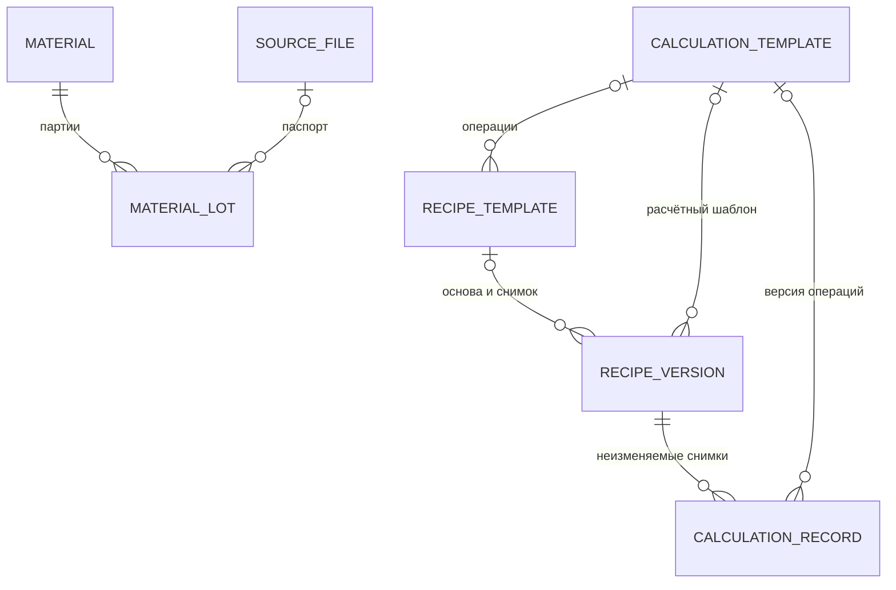

# LIMS 1.1 — зимние серии, источники, партии и расчёты

Дата: 02.11.2026. Статус: реализовано локально. Этот документ фиксирует расширение первой версии по запросу пользователя. Позднее в тот же день отдельно добавлен [ИИ-помощник через Cloud.ru](assistant.md); начальный архивный набор загружается из подготовленного снимка Excel. Произвольная загрузка нового Excel через интерфейс не запускает импорт строк.

Актуализация 03.11.2026: рабочие карточки называются экспериментами;
условия и измерения объединены в группы измерений. Новые рецептуры создаются
в [редакторе состава и заправки](recipe-editor.md); шаблоны рецептур и расчётов
убраны из интерфейса. Текущие действия описаны в [README](../README.md),
границы исследования проекта и БД — в [справке ассистента](assistant.md).
Ниже отдельно отмечены исторические возможности и схемы.

## Рабочие разделы

В основной навигации доступны обзор, рецептуры, эксперименты, история,
группы измерений, типы смесей, материалы, категории материалов, партии сырья,
источники и показатели. Действия создания и изменения доступны автору;
читатель может просматривать записи и скачивать доступные вложения.
Проверка ролей выполняется сервером.

| Раздел | Реализованные действия |
|---|---|
| Типы смесей | Создание и редактирование типа, просмотр связанных версий рецептур. Код использованного типа не меняется. |
| Материалы | Наименование, категория и примечание; список партий с их плотностью и ценой и связанные рецептуры. |
| Категории материалов | Отдельный справочник с названием, описанием, количеством и списком материалов; создание и переименование с историей изменений. Материал без классификации остаётся «Без категории». |
| Партии | Материал, номер, производитель/поставщик, поступление, срок годности, статус, собственные плотность и цена с валютой, паспорт/источник, примечание. |
| Источники | Загрузка файла до 25 МБ, ссылка на документ или текстовая запись; разделы/листы и исходные фрагменты; связи с рецептурами, карточками и паспортами партий. |
| Показатели | Код, название, единица и вид значения. Единица и вид уже использованного показателя не переписываются. |
| Рецептуры | Создание и новая версия из карточки, редактирование черновика, публикация, полиольная смесь, изоцианат и газы, партии, расчёт заправки и первичные ячейки. |
| Эксперименты | Рецептура с основанием связи, даты и статус, группы измерений с показателями и причинами отсутствия значений, дословные наблюдения, обработка, ссылки на первичные ячейки. Завершённая карточка доступна для просмотра. |
| Группы измерений | Общий справочник групп и входящих показателей; добавление группы в эксперимент, заполнение значений или причин их отсутствия. |
| Расчёты | Предварительная оценка, автоматический снимок при публикации, отдельный повторный расчёт по актуальным свойствам, просмотр каждого сохранённого результата. |
| История | Автор, время, действие, изменения «до / после», ссылка на соответствующую сущность, поиск и фильтр по виду записи. |

## Категории материалов

Категория объединяет материалы в пользовательскую группу. Описание категории
объясняет её назначение; в карточке видны входящие в неё марки сырья.
В форме материала категория выбирается из справочника. Переименование
категории переносит её название во все входящие материалы и сохраняет
изменения категории и каждого материала в истории.

Начальный зимний набор включает семь заполненных категорий: «Полиолы»,
«Аминные катализаторы», «Стабилизаторы и регуляторы ячеек»,
«Антипирены и пластификаторы», «Изоцианаты», «Пропелленты и вспенивающие
газы», «Добавки (тип требует уточнения)». Последняя группа отмечает
материалы, для которых точный тип пока требует дополнительного подтверждения.
В справочнике есть описание назначения каждой группы.
Существующие пользовательские категории и их изменения сохраняются.
Материалы, для которых классификация ещё не указана, доступны отдельно
по ссылке «Без категории». При миграции и повторном `seed_initial`
непустые категории, уже записанные у материалов, добавляются в справочник.

## Партии и прослеживаемость

Статусы партии: «Доступна», «Закрыта / израсходована». При публикации нового плана сервер запрещает использовать закрытые и просроченные партии. При обновлении прежний статус «Карантин» заменяется на «Доступна»; сохранённые снимки расчётов и история остаются неизменными. Черновик можно сохранить для дальнейшей проверки. Перед публикацией статус повторно проверяется в транзакции с блокировкой выбранных партий.

В редакторе рецептуры сначала выбирают материал, затем его партию, если она
известна. При смене материала прежняя партия сбрасывается. Производитель /
поставщик, плотность, цена за кг и её валюта принадлежат партии. При обновлении
поставщик материала переносится в его партии, если у партии поставщик не указан.
У материала этих полей нет. Если свойство партии не указано, оно остаётся
неизвестным и не берётся из другой партии. В документе рецептуры можно указать
собственное значение с происхождением либо причину отсутствия. Нулевая цена
является явно известным значением.

Карточка партии показывает её использование в компонентах и плане заправки, связанные версии рецептур и связанные испытания. Материал и номер уже использованной партии нельзя изменить через рабочую форму. Статус и свойства можно обновить с записью в историю; старые сохранённые расчёты остаются прежними.

Это учёт партий и связей планов. Складские приходы/расходы, остатки и подтверждённые фактические навески не выводятся из плановых количеств; они относятся к ранее отложенному учёту изготовления.

## Источники и свойства

У загруженного файла SHA-256 вычисляется по фактическим байтам. Ссылка и текстовая запись не получают вымышленный хеш. Загруженный первичный файл не заменяется: для другой редакции создаётся новый источник. Скачать файл можно через защищённый маршрут после входа; публичной раздачи каталога вложений нет. Шесть исходных книг зимних серий хранятся в `initial_data/sources/`, входят в образ приложения и также доступны по кнопке «Скачать файл». Их SHA-256 проверяется перед скачиванием; исторический исходный путь сохраняется для прослеживаемости.

Файл сохраняется как вложение. Добавление XLSX в источники не импортирует его строки в рецептуры или результаты. Листы/разделы и ячейки/фрагменты сейчас добавляются вручную. Для фрагмента отдельно сохраняются дословное значение либо формула, её кэш и исходный формат. Кэш не считается проверенным результатом расчёта.

В рецептуре и карточке можно выбрать лист источника, а у компонентов, количеств, заправки, свойств, условий и результатов — первичные ячейки. Если выбран общий лист, сервер проверяет принадлежность ячеек этому листу. Изменение листа карточки не должно противоречить уже сохранённым результатам, наблюдениям или обработке.

Свойство плана относится ровно к одному объекту: рецептуре, группе, компоненту или строке заправки. Например, OHV или NCO записываются со значением, единицей и первичной ячейкой. Свойство конкретного плана хранится как историческая запись с собственной первичной ячейкой. При копировании рецептуры эти записи и их происхождение сохраняются.

## Исторические шаблоны рецептур

С 03.11.2026 раздел, формы и маршруты шаблонов рецептур отключены.
Повторное использование выполняется созданием новой версии из карточки
рецептуры. Следующее описание объясняет сохранённые исторические записи.

Шаблон хранил название, номер версии, описание, тип смеси, состав групп,
базу количества и полноту группы, значения по умолчанию, план заправки,
расчётную массу. Шаблон мог содержать выбор материала или партии.

Созданная из шаблона рецептура получала собственные строки состава и заправки,
ссылку на шаблон и снимок его определения. Прежние рецептуры сохраняют эту
историю; наличие ссылки в БД не означает доступность создания из шаблона.

При создании шаблона из рецептуры копировалась плановая структура. Первичные
ячейки и документальные свойства конкретной исторической записи не являются
универсальными доказательствами для будущих рецептур.

## Автоматические расчёты и их результаты

С 03.11.2026 новые и перенесённые зимние рецептуры используют
[редактор из трёх разделов и полный расчёт заправки](recipe-editor.md).
Ниже описан прежний расчёт отдельных групп, сохранённый для совместимости
старых записей без документа исходных параметров.

Все поддерживаемые операции выполняются и показываются автоматически: масса, стоимость и объём компонентов, стоимость группы, цена за кг и аддитивная плотность. Выбор и отдельный справочник шаблонов расчётов удалены. Произвольный Python/JavaScript или текст формулы не исполняется.

Для каждой группы отдельно задаётся расчётная масса `M` в граммах; по умолчанию — 1 000 г. План заправки хранится отдельно и не включается в 100% состава группы.

| Операция | Формула | Единица |
|---|---|---|
| Масса компонента при массовых процентах | `mᵢ = M × wᵢ / 100` | г |
| Масса компонента при массовых частях | `mᵢ = M × pᵢ / Σp` | г |
| Стоимость компонента | `cᵢ = mᵢ / 1000 × ценаᵢ` | Валюта цены |
| Аддитивный объём компонента | `Vᵢ = mᵢ / ρᵢ` | мл |
| Стоимость группы | `C = Σcᵢ` | Общая валюта цен |
| Цена смеси за кг | `C × 1000 / Σmᵢ` | Общая валюта цен / кг |
| Аддитивная плотность смеси | `Σmᵢ / ΣVᵢ` | г/мл |

Для процентного состава сумма должна быть 100% с допуском 0,001%. Части нормируются по положительной сумме. Частичный состав, неизвестная база и пропущенные количества останавливают полный расчёт группы. Отсутствующая цена или плотность оставляет соответствующий итог неизвестным; известная масса при этом может рассчитываться. Нулевая масса даёт нулевой вклад. Исходные десятичные значения сохраняются без подмены пропусков нулями.

Валюта указывается рядом с каждой ценой и стоимостью. Суммарная стоимость
группы рассчитывается при единой валюте её ненулевых компонентов.
Если цены заданы в разных валютах, показывается пояснение и итоговая
стоимость остаётся неизвестной. Автоматического пересчёта валют нет.
Для архивных строк цены и плотности берутся из свойств исходной рецептуры,
чтобы позднее изменение справочника не меняло историческую оценку.

Плотность — аддитивная оценка смеси до реакции. Она не является измеренной плотностью отверждённой пены. Стоимость относится к рассчитываемой группе, а не автоматически ко всему готовому баллону. В интерфейсе результаты округляются для чтения; снимок хранит десятичные строки с полной расчётной точностью.

При публикации рецептуры автоматически создаётся `CalculationRecord` с назначением `publication`. Он фиксирует состав, количества, массу, цены, плотности, происхождение свойств, выбранные партии и результаты всех расчётов. Именно этот снимок показывается как расчёт опубликованного плана. Ручной расчёт черновика не подменяет расчёт публикации.

Повторный расчёт создаёт отдельный снимок с назначением `manual` и отдельное событие истории. Она не переписывает исходный результат. У старых записей без признака назначения показывается первый известный сохранённый расчёт с соответствующей подписью, без утверждения, что он существовал в момент публикации.

## Дополнение модели данных 1.0

Документальное ядро расширено характеристиками и статусами партий,
источниками-вложениями, группами измерений и документом исходных параметров
рецептуры. Прежние общие условия перенесены в результаты групп; отдельная
сущность `SessionCondition` удалена. Материал хранит идентичность марки;
поставщик, плотность, цена и валюта принадлежат партии. Дополнительные сущности:

| Сущность | Назначение и ключевые данные |
|---|---|
| `MaterialCategory` | Справочник названий и описаний категорий. Существующие текстовые значения категорий материалов сохраняются; переименование через интерфейс обновляет состав группы с аудитом. |
| `RecipeTemplate` | Историческая версия плановой структуры; записи и связи сохраняются, пользовательский раздел отключён. |
| `CalculationRecord` | Неизменяемый снимок исходных данных и результатов по рецептуре, автор/время. Назначение снимка записывается в результатах. |
| `MeasurementGroup` | Общая группа показателей; `TestRun` связывает её с конкретным экспериментом. |

Историческая диаграмма первой реализации ниже не описывает действующую схему:
`CalculationTemplate` и все связи с ним удалены миграцией `0012`, а работа
с шаблонами рецептур отключена. Для текущей схемы используйте модели и миграции.



Служебные таблицы происхождения, связей и зависимостей не требуют отдельного пункта меню для каждой таблицы. Например, группа и компоненты редактируются внутри рецептуры, лист и ячейки — внутри источника, определения — через формы результатов. `ResultDependency` и состояния архивных формул остаются в документальном ядре и техническом просмотре; отдельный конструктор вычислений над измерениями в эту версию не добавлен. Автоматические расчёты относятся к плановым составам. Миграция `0012` удаляет сущность расчётного шаблона и ссылки на неё; исходные данные и результаты старых снимков сохраняются. Все показатели старых снимков также доступны при просмотре.

Модели в `lab/models.py` и миграции в `lab/migrations/` задают действующую
схему; применяйте все актуальные миграции. Изменения 0013–0017 вводят группы
измерений и причины отсутствия значений, 0018–0019 упрощают партии и переносят
поставщика, 0020 добавляет `RecipeVersion.formulation`. Прежний демонстрационный
SQL в `examples/relational/` описывает историческое ядро версии 1.0.

## Начальные данные из Excel и обновление

База получает три серии: «Зимняя улучшенная пена» (316), «Зимняя пена»
(302) и «Зимняя пена с фреоном» (316-Ф). Из шести исходных книг
сохранены 135 листов рецептур и 167 карточек испытаний, исходные ячейки,
формулы, кэши и комментарии. Повторы и варианты выдержки остаются
отдельными записями. Единственная подходящая рецептура получает
подтверждённую связь с карточкой испытания (158 карточек); для 6 карточек
с несколькими подходящими рецептурами сохраняются кандидаты, ещё у 3
рецептура в архиве отсутствует. Эти связи не подтверждают фактическое
изготовление по плану. Повторная загрузка обновляет прежние связи-кандидаты,
сохраняя отклонённые связи и рецептуры, выбранные сотрудником.
Подробности и воспроизводимый
экспорт — в [описании начальных данных](../initial_data/README.md).

Профили сотрудников: Гущин Даниил — автор, Иван Иванов — читатель.
Исторические цены и плотности относятся к строке рецептуры. По прямому
указанию пользователя цены начального набора интерпретируются как EUR/кг
без пересчёта чисел; исходные подписи и форматы Excel сохранены отдельно.
Цены и плотности партий заполняются архивными значениями с сохранением
происхождения. Если номер партии в исходной строке отсутствует, свойства
остаются у этой строки рецептуры; общая цена или плотность марки из них
не выводится. Источник каждой исторической строки остаётся в свойствах
рецептуры.

Суффикс `п.` / `П.` с номером отделяется от названия марки и сохраняется
в `MaterialLot`; строка рецептуры ссылается на эту партию. Исходное название
и адрес ячейки остаются доступными. Разные номера партий больше не создают
отдельные материалы. Номер партии без явного обозначения не выдумывается.
Противоречивые обозначения материала сохраняются с пояснением и без
догаданной привязки.

Для существующей локальной базы:

```bash
make upgrade-data
make dev
```

`upgrade-data` сохраняет согласованную копию SQLite в `var/backups/`,
применяет миграции и вызывает `seed_initial`. Известные записи прежнего
демонабора удаляются. Самостоятельные пользовательские записи сохраняются;
авторство записей прежних профилей переносится на Гущина Даниила.
Повторный запуск не создаёт дубликаты. Исправление начального импорта отделяет партии, переносит недостающие свойства и сохраняет пользовательские правки; спорные свойства не заменяются молча.
Старые команды `init-demo`, `upgrade-demo` и `seed_demo` перенаправлены
на заполнение реальными данными.

Первичные книги не меняются. Серверные и браузерные тесты работают
на временных базах; вложения браузерных тестов также временные.

## Проверка реализации

Серверные проверки покрывают права, ограничения данных, источники и вложения,
статусы партий, перенос свойств и ячеек, группы измерений, редактор рецептур,
формулы, нули/пропуски, неизменяемость снимков, замену прежнего демонабора,
точность переноса Excel и разделение ручного расчёта и расчёта публикации.

Браузерная проверка включает основные страницы на широком и мобильном экране:
источники и скачивание вложений, архивный Excel с проверкой SHA-256, партии,
категории и фильтры, группы измерений, создание и новые версии рецептур,
публикацию и повторный расчёт, историю и запрет изменений для читателя.
Команды: `make test-backend`, `make test-frontend`; полный запуск — `make test`.
Отдельная проверка редактора: `npm run test:recipe-editor`.
