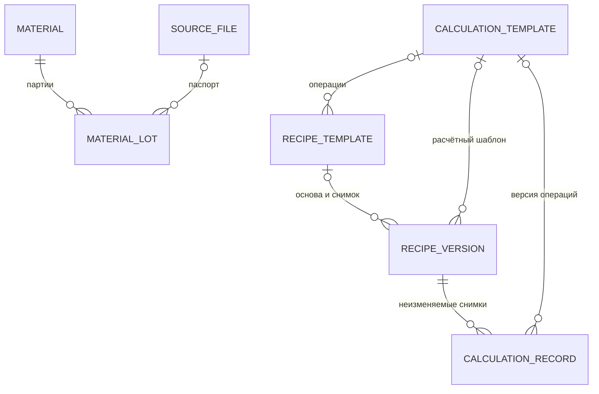

# LIMS 1.1 — зимние серии, источники, партии и шаблоны

Дата: 01.11.2026. Статус: реализовано локально. Этот документ фиксирует расширение первой версии по запросу пользователя. Позднее в тот же день отдельно добавлен [ИИ-помощник через Cloud.ru](assistant.md); импорт данных из Excel остаётся за пределами текущего этапа.

## Рабочие разделы

В основной навигации доступны обзор, рецептуры, испытания, история, шаблоны рецептур, шаблоны расчётов, типы смесей, материалы, партии сырья, источники и показатели. Действия создания и изменения доступны автору; читатель может просматривать записи и скачивать доступные вложения. Проверка ролей выполняется сервером.

| Раздел | Реализованные действия |
|---|---|
| Типы смесей | Создание и редактирование типа, просмотр связанных версий рецептур. Код использованного типа не меняется. |
| Материалы | Наименование, категория, поставщик, справочная плотность в г/мл, цена в ₽/кг, примечание; список партий и связанных рецептур. |
| Партии | Материал, номер, поставщик, поступление, срок годности, статус, собственные плотность и цена, паспорт/источник, примечание. |
| Источники | Загрузка файла до 25 МБ, ссылка на документ или текстовая запись; разделы/листы и исходные фрагменты; связи с рецептурами, карточками и паспортами партий. |
| Показатели | Код, название, единица и вид значения. Единица и вид уже использованного показателя не переписываются. |
| Рецептуры | Создание вручную или из шаблона, редактирование черновика, публикация, новая версия, состав по группам, партии, план заправки, свойства и первичные ячейки. |
| Испытания | Рецептура с основанием связи, даты и статус, общие условия, определения/методы, измерения, дословные наблюдения, обработка, ссылки на первичные ячейки. Завершённая карточка доступна для просмотра. |
| Шаблоны | Создание, просмотр и новые фиксированные версии; создание шаблона из рецептуры, рецептуры из шаблона. |
| Расчёты | Предварительная оценка, автоматический снимок при публикации, отдельный повторный расчёт по актуальным свойствам, просмотр каждого сохранённого результата. |
| История | Автор, время, действие, изменения «до / после», ссылка на соответствующую сущность, поиск и фильтр по виду записи. |

## Партии и прослеживаемость

Статусы партии: «Доступна», «Карантин», «Закрыта / израсходована». При публикации нового плана сервер запрещает использовать партии на карантине, закрытые и просроченные партии. Черновик можно сохранить для дальнейшей проверки. Перед публикацией статус повторно проверяется в транзакции с блокировкой выбранных партий.

В строке состава или заправки выбирают материал без установленной партии либо конкретную партию. У партии известен её материал; одновременно указывать обе ссылки нельзя. Свойства партии имеют приоритет над справочником материала. Если значение партии отсутствует, используется значение материала. Нулевая цена является известным значением и не заменяется справочной ценой.

Карточка партии показывает её использование в компонентах и плане заправки, связанные версии рецептур и связанные испытания. Материал и номер уже использованной партии нельзя изменить через рабочую форму. Статус и свойства можно обновить с записью в историю; старые сохранённые расчёты остаются прежними.

Это учёт партий и связей планов. Складские приходы/расходы, остатки и подтверждённые фактические навески не выводятся из плановых количеств; они относятся к ранее отложенному учёту изготовления.

## Источники и свойства

У загруженного файла SHA-256 вычисляется по фактическим байтам. Ссылка и текстовая запись не получают вымышленный хеш. Загруженный первичный файл не заменяется: для другой редакции создаётся новый источник. Скачать файл можно через защищённый маршрут после входа; публичной раздачи каталога вложений нет.

Файл сохраняется как вложение. Добавление XLSX в источники не импортирует его строки в рецептуры или результаты. Листы/разделы и ячейки/фрагменты сейчас добавляются вручную. Для фрагмента отдельно сохраняются дословное значение либо формула, её кэш и исходный формат. Кэш не считается проверенным результатом расчёта.

В рецептуре и карточке можно выбрать лист источника, а у компонентов, количеств, заправки, свойств, условий и результатов — первичные ячейки. Если выбран общий лист, сервер проверяет принадлежность ячеек этому листу. Изменение листа карточки не должно противоречить уже сохранённым результатам, наблюдениям или обработке.

Свойство плана относится ровно к одному объекту: рецептуре, группе, компоненту или строке заправки. Например, OHV или NCO записываются со значением, единицей и первичной ячейкой. Свойство конкретного плана не изменяет автоматически свойства всей марки сырья. При копировании рецептуры эти записи и их происхождение сохраняются.

## Шаблон рецептуры

Шаблон хранит название, номер версии, описание, тип смеси, состав групп, базу количества и полноту группы, значения по умолчанию, план заправки, расчётную массу и ссылку на версию шаблона расчёта. Шаблон может содержать выбор материала или партии.

Новая рецептура получает собственные строки состава и заправки, ссылку на шаблон и снимок его определения. После этого её можно изменять отдельно. Сохранённые версии шаблонов фиксируются; изменение выполняется созданием следующей версии. Прежние рецептуры сохраняют прежнюю основу.

При создании шаблона из рецептуры копируется плановая структура. Первичные ячейки и документальные свойства конкретной исторической записи не превращаются в универсальные доказательства для будущих рецептур.

## Шаблоны и результаты расчётов

Подход перенесён из `experiment-tracking/formulation-demo`: пользователь выбирает поддерживаемые операции. Произвольный Python/JavaScript или текст формулы не исполняется.

Для каждой группы отдельно задаётся расчётная масса `M` в граммах; по умолчанию — 1 000 г. План заправки хранится отдельно и не включается в 100% состава группы.

| Операция | Формула | Единица |
|---|---|---|
| Масса компонента при массовых процентах | `mᵢ = M × wᵢ / 100` | г |
| Масса компонента при массовых частях | `mᵢ = M × pᵢ / Σp` | г |
| Стоимость компонента | `cᵢ = mᵢ / 1000 × ценаᵢ` | ₽ |
| Аддитивный объём компонента | `Vᵢ = mᵢ / ρᵢ` | мл |
| Стоимость группы | `C = Σcᵢ` | ₽ |
| Цена смеси за кг | `C × 1000 / Σmᵢ` | ₽/кг |
| Аддитивная плотность смеси | `Σmᵢ / ΣVᵢ` | г/мл |

Для процентного состава сумма должна быть 100% с допуском 0,001%. Части нормируются по положительной сумме. Частичный состав, неизвестная база и пропущенные количества останавливают полный расчёт группы. Отсутствующая цена или плотность оставляет соответствующий итог неизвестным; известная масса при этом может рассчитываться. Нулевая масса даёт нулевой вклад. Исходные десятичные значения сохраняются без подмены пропусков нулями.

Плотность — аддитивная оценка смеси до реакции. Она не является измеренной плотностью отверждённой пены. Стоимость относится к рассчитываемой группе, а не автоматически ко всему готовому баллону. В интерфейсе результаты округляются для чтения; снимок хранит десятичные строки с полной расчётной точностью.

При публикации рецептуры автоматически создаётся `CalculationRecord` с назначением `publication`. Он фиксирует состав, количества, массу, цены, плотности, происхождение свойств, выбранные партии и версию расчётного шаблона. Именно этот снимок показывается как расчёт опубликованного плана. Ручной расчёт черновика не подменяет расчёт публикации.

Кнопка «Новый расчёт по текущим ценам» создаёт отдельный снимок с назначением `manual` и отдельное событие истории. Она не переписывает исходный результат. У старых записей без признака назначения показывается первый известный сохранённый расчёт с соответствующей подписью, без утверждения, что он существовал в момент публикации.

## Дополнение модели данных 1.0

Двадцать таблиц утверждённого документального ядра сохранены. Добавлены поля справочных свойств материалов, характеристик и статусов партий, источников-вложений и связей рецептуры с шаблонами. Три новые сущности приложения:

| Сущность | Назначение и ключевые данные |
|---|---|
| `RecipeTemplate` | Неизменяемая версия плановой структуры: название/версия, тип смеси, JSON состава и заправки, масса, шаблон расчёта, автор/время. |
| `CalculationTemplate` | Неизменяемая версия списка разрешённых расчётных операций, описание, автор/время. |
| `CalculationRecord` | Неизменяемый снимок исходных данных и результатов по рецептуре, шаблон, автор/время. Назначение снимка записывается в результатах. |



Служебные таблицы происхождения, связей и зависимостей не требуют отдельного пункта меню для каждой таблицы. Например, группа и компоненты редактируются внутри рецептуры, лист и ячейки — внутри источника, определения — через формы результатов. `ResultDependency` и состояния архивных формул остаются в документальном ядре и техническом просмотре; отдельный конструктор вычислений над измерениями в эту версию не добавлен. Шаблоны расчётов 1.1 относятся к плановым составам.

Миграции приложения — источник фактической схемы: `lab/migrations/0001_initial.py` и `0002_calculationrecord_calculationtemplate_recipetemplate_and_more.py`. Прежний демонстрационный SQL в `examples/relational/` описывает ядро версии 1.0, а не полный состав текущего приложения.

## Начальные данные из Excel и обновление

База получает три серии: «Зимняя улучшенная пена» (316), «Зимняя пена»
(302) и «Зимняя пена с фреоном» (316-Ф). Из шести исходных книг
сохранены 135 листов рецептур и 167 карточек испытаний, исходные ячейки,
формулы, кэши и комментарии. Повторы и варианты выдержки остаются
отдельными записями. Совпадение номеров даёт связь-кандидат и не
подтверждает изготовление по плану. Подробности и воспроизводимый
экспорт — в [описании начальных данных](../initial_data/README.md).

Профили сотрудников: Гущин Даниил — автор, Иван Иванов — читатель.
Исторические цены и плотности относятся к строке рецептуры; неизвестная
валюта не назначается автоматически. Вымышленные партии и результаты
больше не создаются.

Для существующей локальной базы:

```bash
make upgrade-data
make dev
```

`upgrade-data` сохраняет согласованную копию SQLite в `var/backups/`,
применяет миграции и вызывает `seed_initial`. Известные записи прежнего
демонабора удаляются. Самостоятельные пользовательские записи сохраняются;
авторство записей прежних профилей переносится на Гущина Даниила.
Повторный запуск не создаёт дубликаты и не перезаписывает внесённые правки.
Старые команды `init-demo`, `upgrade-demo` и `seed_demo` перенаправлены
на заполнение реальными данными.

Первичные книги не меняются. Серверные и браузерные тесты работают
на временных базах; вложения браузерных тестов также временные.

## Проверка реализации

Серверные проверки покрывают права, ограничения данных, источники и вложения, статусы партий, перенос свойств и ячеек, шаблоны, формулы, нули/пропуски, неизменяемость снимков, замену прежнего демонабора, точность переноса Excel и разделение ручного расчёта черновика и расчёта публикации.

Браузерная проверка включает 30 страниц на широком и мобильном экране: создание источника и скачивание вложения, партии и карантин, создание/версии шаблонов, рецептуру из шаблона, публикацию и повторный расчёт, историю и запрет изменений для читателя. Команды: `make test-backend`, `make test-frontend`; полный запуск — `make test`.
